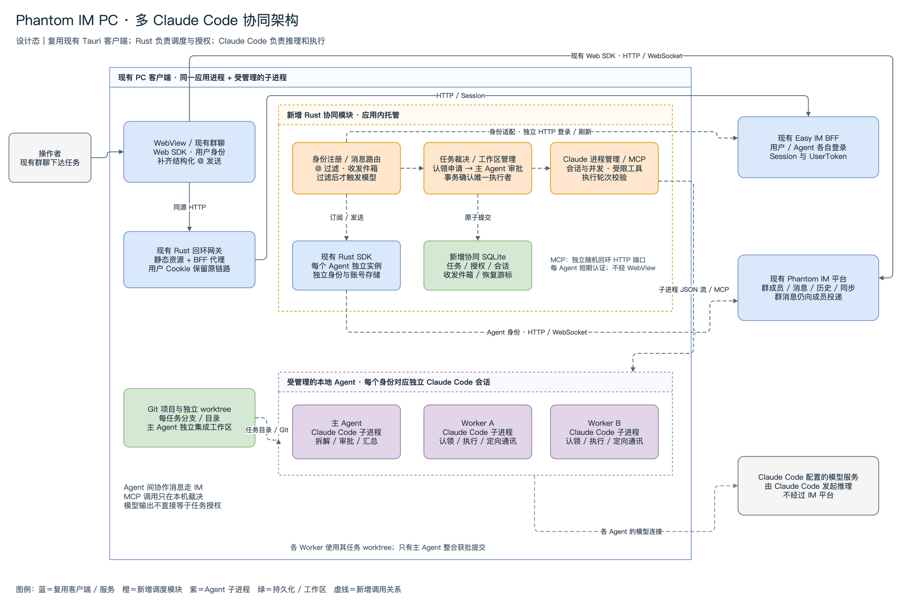
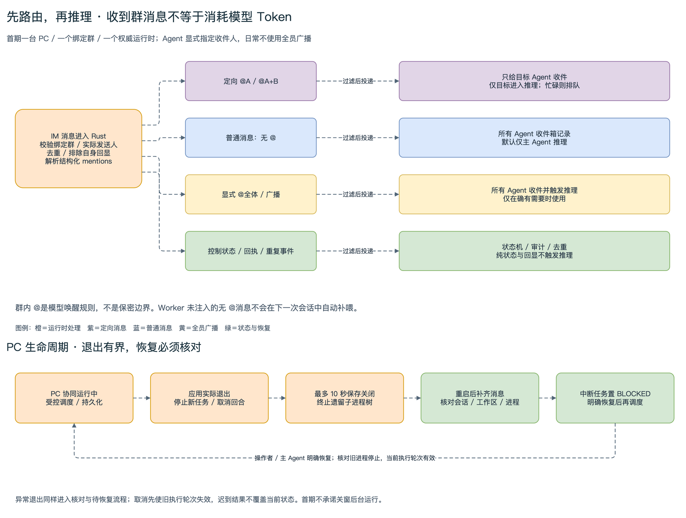
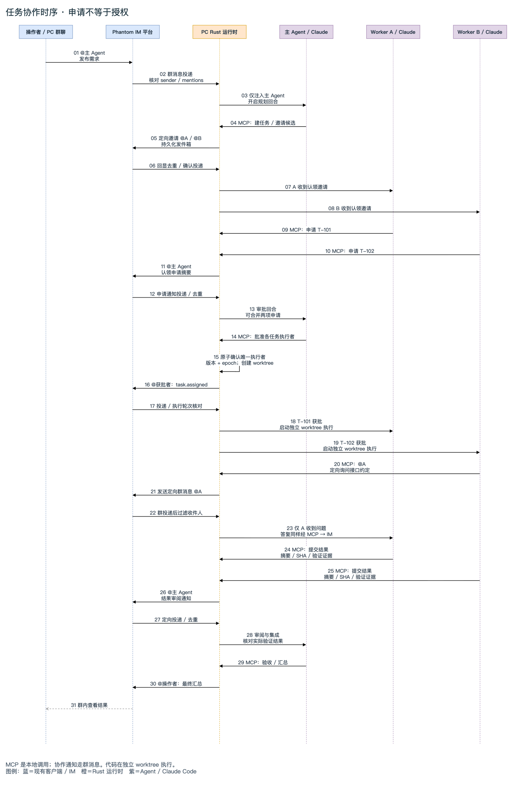

# 基于 Phantom IM PC 客户端的 Claude Code 多 Agent 协同方案

日期：2026-11-16。状态：设计稿，尚未实现协同运行时。设计分支：`feature-agent-cc`，基于已包含 Rust SDK 的 `feature/rust-sdk`。

后续开发的产品需求输入见 [PRD 需求文档](prd-agent-phantom.md)，包含需求编号、业务规则及验收场景；本文提供技术方案与组件通讯设计。

本文设计如何复用现有 Tauri PC 客户端，让一名用户在 IM 群里指挥本地多个 Claude Code Agent：主 Agent 拆解任务，Worker 申请认领，主 Agent 审批，Worker 执行并定向交流，最后由主 Agent 审阅和汇总。IM 是协作消息通道，PC Rust 后端是任务状态的裁决点，Claude Code 是执行任务的进程。

本次交付只有设计文档、可编辑 draw.io 图稿和图片预览；不包含运行时代码、真实 Agent 启动、建群、模型调用或 Token 节省率的实测结果。

## 1. 已确定的产品规则

| 问题 | 本方案选择 |
| --- | --- |
| 客户端 | 复用现有 Phantom IM PC 客户端及现有群聊，不新增独立客户端或任务看板 |
| Agent 运行方式 | PC Rust 后端统一管理多个独立 Claude Code 会话和子进程 |
| Agent 身份 | 每个 Agent 使用独立 IM 用户身份，主 Agent 也是群成员 |
| 任务认领 | Worker 申请认领，主 Agent 审批；运行时原子确认唯一执行者后才开工 |
| Agent 间通讯 | 在同一群里使用结构化 @，允许定向给一个或多个 Agent |
| 无 @ 消息 | 所有 Agent 的本地收件箱可见，默认只有主 Agent 进入推理 |
| @全体 | 显式触发全部 Agent；用于确有必要的协作，不用于常规状态通知 |
| 代码隔离 | 每个任务独立 Git worktree 和分支，主 Agent 使用独立集成工作区 |
| 结果交付 | Worker 定向提交主 Agent，主 Agent 审阅、整合后给用户汇总 |
| 首期部署 | 一台 PC、一个协同项目、一个绑定群、一个主 Agent、多个 Worker；同一群只有一个权威运行时 |

“所有 Agent 看见”指运行时将无 @ 消息记录到每个 Agent 的收件箱，不等于把它塞进全部 Claude 会话。群内 @ 控制推理触发，不是访问隔离：群成员仍可能从 IM 历史读取消息。

## 2. 仓库现状与复用边界

以下是本次只读核对所得的现状；后续章节的协同模块均为新增设计。

| 现有组件 | 已有能力 | 本方案复用及缺口 |
| --- | --- | --- |
| [PC 客户端](../../../phantom-im/clients/pc/README.md) | Tauri 2；复用 Web 生产构建；Rust 提供回环同源网关、配置和诊断 | 在 Rust 后端增加协同运行时；现有工程还没有 Agent 管理和 Rust SDK 依赖 |
| [PC Rust 入口](../../../phantom-im/clients/pc/src-tauri/src/lib.rs) | 创建窗口、启动本地网关、注册少量桌面命令、退出时停止网关 | 增加协同运行时生命周期与有界退出处理；不把模型执行放到 WebView |
| [Web 消息网关](../../../phantom-im/clients/web/src/phantom/gateway.ts) | 用户使用 Web SDK 收发消息；`sendText` 目前未传递 `mentions` | 补齐群成员 @ 选择和 `mentions` 透传，继续使用现有群聊页面 |
| [BFF](../../../phantom-im/bff/README.md) | 账号登录、Session、UserToken 与平台 HTTP 代理 | Agent 使用独立正常登录会话或用户配置的短期 Token 引用，不借用操作者身份 |
| [Rust SDK](../../../phantom-platform/sdks/rust/README.md) | 多实例、收发、群、订阅、历史、同步、SQLite 和自定义存储 | PC 后端直接依赖 `phantom-sdk`，每个 Agent 持有独立实例；测试 CLI 用于后续诊断，不作为常驻服务 |
| [消息协议](../../../phantom-platform/contracts/proto/phantom/v1/message.proto) | `mentions` 是用户 ID 列表，`ALL` 表示 @全体 | 复用现有字段；首期不增加服务端协议字段或复用系统消息冒充协同事件 |

用户现有链路保持为 WebView → Web SDK → Phantom；Agent 新增链路为 PC Rust → Rust SDK → Phantom。现有 Rust 回环网关继续提供静态资源和 BFF 代理，Agent 的长连接不绕行 WebView。

工具链也需作为后续实施项处理：PC 当前清单声明 Rust 1.77.2、edition 2021；SDK 固定 Rust 1.99.1、edition 2024。接入时将 PC 构建工具链和最低版本统一到满足 SDK 的版本，重新验证 Tauri 打包；不把 PC 现有跨平台验收等同于新增协同能力已跨平台验收。

本机只读检查的 Claude Code 为 `2.1.325`，`claude --help` 列有 `--print`、`--input-format stream-json`、`--output-format stream-json`、`--resume`、`--session-id` 和 `--mcp-config`；`claude mcp add --help` 列有 HTTP transport。本方案以这些本机接口为适配依据，尚未启动进程验证输入帧、工具调用与恢复行为。后续首先完成适配原型，不假设任意安装版本兼容。

## 3. 部署与组件架构



[编辑 draw.io 图稿：第 1 页「部署与组件」](diagrams/agent-collaboration.drawio)。蓝色表示复用的客户端/服务，橙色表示新增调度组件，紫色表示 Agent/Claude Code 子进程，绿色表示持久化与工作区。虚线表示新增调用关系，图中的新增能力不是现有实现。

### 3.1 PC 进程内的新增模块

| 模块 | 责任 | 不交给模型的确定性工作 |
| --- | --- | --- |
| `CollaborationRuntime` | 启停、绑定群和项目、汇合下述模块 | 单运行时锁、退出屏障、恢复扫描 |
| `AgentRegistry` | 维护逻辑 Agent、IM 身份、角色、能力与会话的绑定 | 验证真实发送人，阻止 Agent 冒充其他身份 |
| `ImBridge` / `MessageRouter` | 管理各 Agent 的 SDK 实例、收件箱、发件箱及定向路由 | @解析、去重、触发过滤、补齐游标，不调用 LLM 参与过滤 |
| `TaskCoordinator` | 任务、申请、审批、执行轮次与结果验收 | 事务确认唯一执行者；拒绝过期版本和越权操作 |
| `ClaudeProcessManager` | 创建或恢复会话、收发流式帧、记录执行状态 | 每 Agent 串行推理、限制并发、超时与进程回收 |
| `CollaborationMcp` | 为 Claude Code 提供受限协同工具 | 工具身份、任务授权、参数及幂等校验 |
| `WorkspaceManager` | 管理任务 worktree、分支及产物 | 路径校验、干净基线、记录基线和提交，不覆盖用户目录 |
| `CollaborationStore` | 持久化任务、收件/发件、身份映射和审计 | SQLite 事务、唯一约束、状态恢复与日志脱敏 |

Agent 的任务拆解与判断在 Claude Code 中完成；身份绑定、消息过滤、任务裁决和进程控制都在 Rust 中完成。主 Agent 通过工具提出审批，工具成功并落库才算授权，群里一句“你来做”不直接启动 Worker。

协同数据库与 SDK 自己的消息数据库分开。SDK 的消息同步成功只表示消息已进入 SDK 存储，不表示任务状态已提交；协同层通过稳定消息 ID、收件游标和幂等操作弥合这一边界。

### 3.2 服务与通讯边界

| 源 → 目标 | 通道 | 用途 |
| --- | --- | --- |
| WebView → 现有 PC 网关 → BFF | 现有同源 HTTP | 用户登录、Session、Token、平台 HTTP 请求 |
| WebView → Phantom | 现有 Web SDK HTTP / WebSocket | 操作者的群聊、@与消息展示 |
| PC Rust → BFF | 独立 HTTP 会话 | 各 Agent 正常登录及获取/更新其本人的 UserToken |
| PC Rust → Phantom | Rust SDK HTTP / WebSocket | 各 Agent 的群成员操作、消息收发、历史和同步 |
| PC Rust → Claude Code 子进程 | 子进程 stdin/stdout，结构化流 | 发起一次推理、恢复会话、消费输出；stderr 单独限量诊断 |
| Claude Code → PC Rust MCP | 新增、独立的回环 HTTP MCP 监听器 | 定向消息、认领、审批和结果提交 |
| Claude Code → 模型服务 | Claude Code 已配置的模型连接 | 模型推理；不经过 IM，不由 PC 转存模型凭据 |
| PC Rust / Claude Code → Git worktree | 本地文件系统及 Git 子进程 | 执行任务、测试、提交和主 Agent 整合 |

MCP 使用独立随机回环端口，不加入可被 WebView 任意调用的通用代理。每个 Agent 的 MCP 访问凭据仅允许其身份对应的工具权限，绑定本次运行时；校验 Host、Origin 和认证，不仅依赖“只监听 localhost”。PC 配置页面/桌面内部控制命令与 Agent MCP 是两类入口，不能互换凭据。

首期只允许一个协同运行时拥有绑定群。PC 以本地项目锁防止重复启动；同群重复配置到另一台机器须由操作者先停用旧运行时，首期不提供跨机器抢占或分布式主节点选举。

### 3.3 Agent 身份与项目配置

用户预先准备专用群和授权测试/业务账号，将操作者、主 Agent 和 Worker 加入同一群；邀请若返回待审批，应走实际审批流程，不能把发出邀请当成已入群。开启前核对每个身份登录结果、群成员状态和权限。运行时不自动注册账号或修改现有好友关系。

配置存于应用私有目录，至少包含：项目 ID、项目根目录、群会话 ID、允许操作者的 IM ID、主 Agent ID、各 Worker 的 IM ID/能力、凭据引用、Claude 可执行文件位置和并发限制。群里只能引用已注册逻辑名称；身份以服务返回的用户 ID 为准，不从显示昵称推断。

凭据使用系统凭据存储或私有文件引用。Agent 的 BFF Cookie jar 相互隔离，也与 WebView Cookie 隔离；Token 通过正常 BFF 流程获取，不在群消息、MCP 返回、命令行参数、项目配置正文或仓库中传递密码/Token。

## 4. 群聊操作与消息路由



[编辑 draw.io 图稿：第 3 页「路由与生命周期」](diagrams/agent-collaboration.drawio)。图中区分 IM 投递、逻辑收件、模型推理和退出恢复；旁路状态事件写入数据库即可，不触发 Agent 对话。

### 4.1 复用现有群聊

任务、认领、审批和结果都在现有群聊可阅读。首期只补齐群成员 @ 和少量可解析命令，不增加看板，也不要求用户手工填写 JSON。输入区选择成员后，同时维护正文显示和独立 `mentions` 列表；编辑或删除 @ 时同步更新列表。WebView、消息网关与 Web SDK 发送参数需一起透传。仅输入相同的 `@昵称` 字符串而没有结构化 mention 时，仍视为普通文本。

应用启动时读取本地协同配置，启用后建立收件连接。群命令使用 `/cc` 前缀，由运行时直接解析，不消耗模型 Token：

| 示例 | 行为 |
| --- | --- |
| `/cc start` / `/cc stop` | 已授权操作者启动或停止已配置的项目；未启用项目时先在本地配置，不靠群消息引导首次配置 |
| `/cc agents` / `/cc status` | 返回已注册 Agent 和任务简表；不唤醒 Claude |
| `/cc approve T-101 worker-a` | 操作者显式覆盖审批；仍经过唯一执行者事务检查 |
| `/cc cancel T-101` | 取消任务并使当前执行轮次失效 |
| `/cc resume T-101` | 明确恢复中断任务，先核对本地工作区与历史 |
| `/cc broadcast <内容>` | 等价于明确的全员推理请求；不自动添加无关群成员 |

`stop` 停止模型执行和新任务，保留最小群控制监听以便接收 `start`；应用退出或本地禁用则关闭所有连接。普通自然语言仍交目标 Agent 理解，不能被解析为具有审批效力的命令。未知/格式错误的命令由运行时返回帮助，不转交全体 Agent 猜测。

### 4.2 路由矩阵

| 消息类型 | 协同层收件 | 推理触发 | 后续处理 |
| --- | --- | --- | --- |
| 普通消息，@主 Agent | 主 Agent | 主 Agent 一次 | 需求理解、协调或审阅 |
| 普通消息，@Worker A | Worker A | 仅 A；忙碌则排队 | 不自动转发给主 Agent 或其他 Worker |
| 普通消息，@A 与 @B | A、B | A、B 各一次 | 发送方承担额外上下文成本 |
| 普通消息，无 @ | 所有 Agent 的收件箱 | 默认仅主 Agent | Worker 标为未注入上下文，之后也不自动补喂 |
| 普通消息，@全体或显式广播 | 所有 Agent | 全部 Agent | 建议简短；自发广播默认禁止，操作者可显式发起 |
| `task.assigned` 控制事件 | 任务状态机及获批者 | 获批 Worker 一次 | 执行轮次有效且依赖满足才启动 |
| 认领/审批/完成等控制事件 | 状态机及声明收件人 | 只在需要主 Agent 决策或审阅时触发 | `agent.status`、回执等纯状态事件不触发 |
| 自身回显、重复事件、历史状态回放 | 去重/状态存储 | 不触发 | 不形成“已收到”的互相回复循环 |

无效或无法解析的定向目标返回错误，不回退为无 @广播。自身回显去重以来源身份和对应收件箱为界：同机另一个目标 Agent 收到这条消息时仍正常路由，不能因为发送端也是本机就全局丢弃。

运行时只信任实际 `sender_id`、绑定群、成员身份和权限；正文写着“我是主 Agent”没有授权意义。Agent 发消息必须显式指定目标，默认工具要求至少一个有效目标；发送给操作者也要 @操作者，避免结果汇总成为一次无意的 Agent 广播。群内所有人仍能看到结果。

启动/恢复时按持久化应用游标补齐消息，而不是只靠实时订阅。首次绑定默认从已记录的启用基线开始，不把整段旧群聊当新任务；需要导入历史由操作者明确选择。`EventLagged` 后重建订阅并按 SDK 快照/历史补齐，补齐完成前不启动新执行。

## 5. 任务认领、执行与验收



[编辑 draw.io 图稿：第 2 页「任务协作时序」](diagrams/agent-collaboration.drawio)。图中 MCP 调用留在本机；持久化的协作通知和 Agent 对话都走 IM。运行时自己的消息回显只核对，不重复应用任务状态。

### 5.1 状态与原子授权

| 状态 | 进入条件 | 允许的下一步 |
| --- | --- | --- |
| `DRAFT` 待分配 | 主 Agent 建立任务，含目标与验收标准 | 开放认领、取消 |
| `OPEN` 开放认领 | 主 Agent 指定候选 Worker，依赖已登记 | 接收认领申请、取消 |
| `CLAIM_PENDING` 待审批 | 至少一个有效申请；可同时保留多个候选申请 | 主 Agent 审批、撤回后回到 OPEN、取消 |
| `ASSIGNED` 已分配 | 审批事务确认唯一 Worker，生成新执行轮次 | 工作区准备成功后 RUNNING，或阻塞/取消 |
| `RUNNING` 执行中 | 获批 Worker 接收任务、worktree 就绪 | 提交结果、阻塞、失败、取消 |
| `REVIEW_PENDING` 待验收 | 结果已落库，主 Agent 收到定向审阅通知 | 验收完成，或带反馈重新开放任务 |
| `DONE` 已完成 | 主 Agent 验收任务产物与验证证据 | 只读；新增需求建立新任务 |
| `BLOCKED` 阻塞 | 权限、认证、依赖、进程中断或预算不足 | 操作者/主 Agent处理后明确恢复，或取消 |
| `FAILED` 失败 | 本轮不可恢复错误 | 主 Agent 明确重开并生成新执行轮次，或取消 |
| `CANCELLED` 已取消 | 授权操作者或主 Agent 取消 | 终态；后续需求建立新任务 |

审批在一个本地 SQLite 事务中校验 `task_id + expected_version`、审批身份、Worker 申请和任务状态，再写入唯一执行者、递增版本并生成 `assignment_epoch`。事务同时写发件箱和待启动动作。并发审批只有一项成功，其余返回版本冲突，不根据群消息到达先后让模型自行判断。

认领阶段的 Worker 使用独立临时会话目录，只开放必要协同工具，不授予项目代码读写权限；获批后才在任务 worktree 启动执行会话。认领不等于授权。MCP 返回 `claim_pending` 时 Worker 只等待，不创建 worktree、不读项目大范围上下文、不开始编码。模型级的任务分配判断由主 Agent 完成，唯一执行权由确定性代码确认。

同一 Worker 同时最多执行一个任务；等待消息排队，未获批任务不唤醒执行会话。任务依赖未完成时可登记申请，但不能进入 RUNNING。主 Agent 工作量与 Worker 并发分开配置，防止 Worker 占满并发后主 Agent 无法审批。

### 5.2 跨 Agent 通讯

Worker A 可通过 `send_message(targets=[worker-b], task_id=...)` 提问。Worker B 的运行时将其排入对应会话，不启动第二个同任务进程；B 的答复必须定向 @A。涉及另一个任务的上下文时只提供获准的摘要和产物引用，不把 A 的完整会话复制给 B。

主 Agent 不自动参加每次问答。提问发生依赖阻塞、职责变更或长时间无回应时，由 A 主动 @主 Agent报告。运行时为对话记录 `correlation_id`、`reply_to` 和最大往返次数；达到配置上限后报告阻塞，避免 Agent 互相唤醒形成无界对话。

### 5.3 代码与结果

获批后从项目已记录的干净基线创建 worktree，分支使用 `agent-cc/<project>/<task>/<epoch>`。任务记录基线 SHA、worktree 绝对路径、负责人和执行轮次；创建失败不复用其他任务目录。未提交的用户改动不自动复制，发现基线不干净则阻塞并提示操作者。

Worker 的读写目录限定为其获批工作区；权限配置是协作约束，不宣称 worktree 本身构成操作系统沙箱。默认不允许 Worker 删除其他 worktree、推送远端或合并主分支。

结果提交至少包含：任务与执行轮次、完成摘要、提交 SHA、修改范围、实际验证命令及结果、未验证部分和遗留问题。未实际运行的测试不能记为通过。主 Agent 在独立集成 worktree 中检查任务分支、选择性整合提交、运行必要验证，并输出汇总。

`DONE` 表示任务验收完成，不等同于自动发布。推送、合入目标分支和清理 worktree 需遵守操作者已有授权；存在未提交文件时不得自动强制删除工作区。

## 6. 协同事件与本地接口

### 6.1 群消息载荷

首期复用普通 TEXT 消息，正文先展示简短可读摘要，再附一个版本化 JSON 块。普通客户端可阅读，不需要先开发自定义消息卡片。以下为设计格式，示例 ID 均为虚构占位值，不代表现有平台账号。

````text
@主Agent [T-101] Worker A 申请认领：补齐群聊 mentions 发送链路，预计提交代码与测试结果。

```agent-cc
{"protocol":"agent-cc","version":1,"event_id":"evt-demo-001","type":"task.claim_requested","project_id":"demo","task_id":"T-101","assignment_epoch":0,"correlation_id":"req-demo-001","payload":{"candidate_agent_id":"worker-a","expected_version":2}}
```
````

外层 IM 消息同时设置 `mentions=[主Agent的真实IM用户ID]` 和稳定 `client_msg_id`。正文里的展示 @ 不替代结构化字段；事件块不接受自行声明的可信发送者或接收人。接收角色和身份从外层消息与本地注册表校验。

| 字段 | 规则 |
| --- | --- |
| `protocol` / `version` | 固定命名和兼容版本；未知版本只展示并记录诊断，不执行 |
| `event_id` | 逻辑事件唯一 ID；发件箱重试使用相同 ID 和 `client_msg_id` |
| `type` | 固定允许列表；例如 task.created、task.claim_requested、task.assigned、task.result_submitted、task.accepted、task.blocked、agent.status |
| `project_id` / `task_id` | 必须匹配绑定群/项目及已有任务；只有授权创建操作可新增任务 |
| `assignment_epoch` | 任务执行相关事件必填；与当前轮次不符则保留审计但拒绝修改状态 |
| `correlation_id` | 对话或请求关联；不作为鉴权材料 |
| `payload` | 按事件类型校验；任务变更包含 `expected_version`，结果包含提交与验证引用 |

文本发送受 SDK 现有 1–5000 Unicode 码点限制。默认单条可读摘要不超过 1000 码点，整条消息必须通过 SDK 校验；详细日志留在本地，群里只发送摘要与有限产物引用。长文件使用现有媒体能力并附说明，不把本地绝对路径误当作其他客户端可下载链接。

控制事件由运行时产生并持久化后发送；Claude 输出中的伪 JSON 或用户粘贴的事件示例不直接修改状态。外部群消息中的协同事件只有在来源为已绑定 Agent、事件类型和当前授权均有效时才能进入校验流程；首期本机拥有的任务写操作仍由本地工具裁决。

### 6.2 本地控制与 MCP 工具

桌面控制接口拟提供 `collaboration_start`、`collaboration_stop`、`collaboration_status`，只接受已配置项目 ID；不接受任意命令、任意仓库路径或 Token 正文。仅对现有主窗口和受信来源授权，原有普通 Web 部署不暴露本地执行能力。

| MCP 工具 | 允许调用者 | 主要输入及输出 |
| --- | --- | --- |
| `create_task` / `open_claims` | 主 Agent | 目标、验收、候选和依赖 → 任务 ID、状态版本 |
| `request_claim` | 被邀请 Worker | 任务 ID、理由、期望版本 → 申请 ID、待审批状态 |
| `approve_claim` | 主 Agent | 申请 ID、期望版本 → 唯一执行者、执行轮次 |
| `send_message` | 已注册 Agent | 目标列表、任务、摘要、关联 ID → 发件箱事件 ID及投递状态 |
| `get_task` / `list_my_tasks` | 已注册 Agent | 任务查询 → 授权范围内的状态与必要上下文 |
| `report_blocked` / `submit_result` | 当前执行者 | 任务、执行轮次、原因或结果 → 新状态版本 |
| `accept_result` / `reopen_task` | 主 Agent | 结果 ID、期望版本、反馈 → 完成状态或新一轮任务 |

每次工具调用由运行时绑定 `agent_id`，不让模型传入一个任意身份充当调用者。写操作带 `operation_id`，以“项目、调用者、操作 ID”去重；同 ID 不同参数返回冲突。`send_message` 返回“已入发件箱”与“平台确认”两类状态，不能把本地排队成功显示为其他 Agent 已完成处理。

MCP 端口和短期凭据通过每个 Agent 独立的临时配置传给 Claude Code，配置权限受限，退出后失效。模型可以看到任务数据，但不获得其他 Agent 的 IM Token、Cookie 或 MCP 凭据。

## 7. Claude Code 会话与应用生命周期

### 7.1 执行适配

PC 使用直接子进程调用而非拼接 shell。固定可执行文件、参数、工作目录及受控环境变量，用户群消息只进入结构化输入，不成为可执行参数。

每个 Agent 保持逻辑会话，任务执行会话绑定 worktree。首期采用一次受控推理回合一个 `claude --print` 子进程、`--input-format stream-json` / `--output-format stream-json` 交换帧；同任务后续回合通过记录的会话 ID 恢复。运行时在每次正常结束后保存结果与会话 ID，再调度下一条消息，不让多个进程并发恢复同一会话。

主 Agent 的规划会话与集成工作区绑定；Worker 新任务使用新会话，恢复同任务才复用会话。不同 worktree 不静默共享同一 Worker 的历史，以免旧任务代码和提示污染新任务。

流式 stdout 是协议通道，不直接逐片发送到 IM；stderr 限量记录诊断。只有明确状态变更、需要决策的问题和最终结果才形成群消息。进程正常输出一段话不代表工具调用成功或任务完成。

权限沿用 Claude Code 的受控权限模式，不默认启用跳过全部权限的参数。需要人工授权的操作使任务进入 BLOCKED，在群里定向通知操作者；确认后由运行时按精确操作恢复，不把群里的任意“同意”扩展为通用执行授权。MCP 协同工具和项目代码执行权限分别管理。

### 7.2 持久化与退出

建议持久化实体为 `projects`、`agents`、`tasks`、`claims`、`assignments`、`sessions`、`inbox`、`outbox`、`workspaces`、`audit_events`。任务 ID 与版本、申请唯一键、当前有效执行者及消息去重键由数据库约束保证。

SDK 的账号存储使用独立 Agent 身份与 SDK 命名空间。协同收件箱以“项目、Agent、IM 消息 ID”去重，发件箱以逻辑事件 ID 去重；本地任务事务与平台发送不做跨系统事务，使用发件箱重试。平台已确认但本地未记录的发送，使用同一个 `client_msg_id` 重试并核对结果。

| 场景 | 处理规则 |
| --- | --- |
| PC 实际退出 | 停止新调度，取消回合，等待最多 10 秒保存和关闭；对未退出子进程终止进程树，保留待恢复记录 |
| 关闭窗口但应用仍驻留 | 只有未来明确实现托盘驻留后才允许后台执行；首期不承诺关窗后继续工作 |
| PC 异常退出 | 重启后检查遗留进程和 worktree；任务标记 BLOCKED/待恢复，完成状态不得推断 |
| IM 断线 | SDK 重连补齐；不因发送确认丢失重复启动执行；本地已授权任务可继续，结果留发件箱 |
| SDK 事件溢出 | 重订阅并恢复快照/历史，按应用游标去重；恢复期间暂停新任务分配 |
| Token 到期 | 暂停对应身份通讯，用其独立 BFF 会话正常刷新；失败则定向请求操作者重新登录 |
| Claude Code 崩溃/超时 | 保存最后可解析状态，任务 BLOCKED；核对修改与子进程后明确恢复，不自动重做有副作用操作 |
| 任务取消 | 先递增执行轮次使旧授权失效，再取消进程；迟到结果只保留审计，不进入验收 |
| 预算/消息队列到上限 | 暂停新推理并定向报告；不静默丢弃任务消息，也不自动提高预算 |

租约/进程心跳仅判断本地可用性，续约由运行时完成，不要求模型定期思考。进程消失或心跳失效不会立即让另一个 Worker 开工：必须先使旧轮次失效并确认旧进程停止，再重新审批。

## 8. Token 控制与观测

节省 Token 的关键是过滤发生在 Claude Code 之前，而不是先把群消息输入所有模型再要求它们不要回应。

| 控制点 | 首期默认值或规则 |
| --- | --- |
| 普通消息 | 无 @只唤醒主 Agent；Agent 工具发送必须指定目标 |
| 并发 | 默认最多两个 Worker 推理，主 Agent 预留一个独立推理名额；每 Agent 单回合串行 |
| 认领 | 主 Agent 定向邀请候选；运行时处理认领状态，不广播唤醒所有 Worker 抢任务 |
| 上下文 | 基础任务说明、当前任务相关消息及按需产物；不加载整个群历史或其他 Worker 会话 |
| 会话隔离 | 新任务新会话；同任务按会话 ID 恢复，不反复附加完整历史 |
| 问答 | 同一关联对话默认最多 4 次 Agent 间发送，超限报告主 Agent 决策 |
| 输出 | 默认摘要不超过 1000 码点；不转发思考过程、终端逐行日志或流式 token |
| 空闲 Agent | 无定时模型轮询；消息订阅、心跳、状态查询由 Rust 完成 |
| 预算 | 每任务和项目均可配置上限；未配置时不编造价格或声称有金额限额 |

记录收到消息数、定向/广播数、过滤数、推理触发数、排队时长、任务轮次、审批冲突、消息重试及恢复次数。Claude Code 若输出可用 usage 则记录实际输入/输出 Token；缺失时记为未知，不从字符数冒充计费 Token。

后续用同一任务集比较“全部群消息触发推理”与本方案的推理次数、实际 usage、完成率和延迟。必须同时报告任务是否完成，不能只用少调用来宣称效果更好。本设计不声称已测得节省比例。

## 9. 完整协作示例

示例只有一名用户、一名主 Agent和 Worker A/B，任务是为一个项目补齐接口与测试；正文 @均通过成员选择产生结构化 mentions。

| 步骤 | 群消息/本地动作 | 被唤醒的 Agent |
| --- | --- | --- |
| 1 | 用户 @主 Agent：“补齐接口与测试，完成后给我汇总。” | 主 Agent |
| 2 | 主 Agent 创建 T-101（接口）与 T-102（测试），明确范围和验收；两项可按约定接口先并行，T-102 最终验证使用 T-101 产物，不登记阻止启动的前置依赖 | 无额外推理，由工具提交状态 |
| 3 | 主 Agent @A 邀请认领 T-101，@B 邀请认领 T-102 | A、B 各自收到自己的邀请 |
| 4 | A/B 各自调用 request_claim；运行时发送待审批摘要给主 Agent | 主 Agent 的审批回合可合并处理两项申请 |
| 5 | 主 Agent approve_claim；运行时原子分配，准备两个独立 worktree | A/B 在各自任务内开始执行 |
| 6 | B @A：“T-101 的错误码约定是什么？”A @B 回复接口约定 | 仅 A、B 对应回合；主 Agent不接收问答上下文 |
| 7 | A 提交结果和验证证据并 @主 Agent | 主 Agent审阅；B 按明确产物引用获取接口提交 |
| 8 | B 基于获准的接口提交补齐测试，提交实际验证结果并 @主 Agent | 主 Agent |
| 9 | 主 Agent在集成 worktree 整合并验证，验收两个任务 | 主 Agent；运行时记录状态，不广播唤醒 |
| 10 | 主 Agent @用户汇总提交、测试和遗留事项 | 无其他 Agent自动参与推理 |

若用户直接发出无 @ 的新需求，所有收件箱记录，仍只由主 Agent判断是否建立任务。若两个 Worker 同时申请一个任务，主 Agent选择一位；另一个收到未获批状态，不执行重复工作。

## 10. 分阶段实施与验收

### 阶段一：PC 复用与执行适配原型

统一 PC/SDK 工具链，建立协同模块边界；验证一个 Agent 正常登录、结构化 @收发、Claude Code JSON 流/MCP/会话恢复和有界退出。只使用隔离目录与专用账号，不以已有 PC 打包成功替代新增链路验收。

### 阶段二：任务闭环与群聊接入

补齐现有输入区 @、身份注册、路由、MCP、SQLite 状态机、认领审批、worktree 和结果汇总；实现本文完整示例，确保任务唯一执行者来自事务而非模型文本。

### 阶段三：恢复、预算和平台验收

补齐发件箱、重连补齐、进程回收、取消轮次、预算与观测；先在 macOS 验收，再在 Windows/Linux 原生环境验证子进程树、路径、权限、Claude 安装探测和 Tauri 打包。首期不实现远程 Worker、多 PC 共同调度、主节点自动选举或跨群任务迁移。

| 验收场景 | 可检查结果 |
| --- | --- |
| @A、@A+B、无 @、@全体 | 分别只产生 1、2、1、全部对应 Agent 的推理触发；无 @的 Worker 收件记录标为未注入 |
| 伪 @昵称、未知 ID、离群身份 | 不误投；错误可定位，不回退为广播 |
| 两个 Worker 同时认领、重复审批 | 只有一个当前执行者，未获批者没有工作区和执行进程 |
| Worker @Worker | 目标收到相关上下文，其他会话没有新增推理输入 |
| 状态回执、自己回显、历史重放 | 无模型互相唤醒循环，任务不重复创建/执行 |
| Worktree 并行修改与整合冲突 | 工作区独立；冲突交主 Agent，未提交用户文件保留 |
| 断线、EventLagged、发送确认丢失 | 消息补齐、发件箱幂等；不声称跨层天然 exactly-once |
| PC/Claude 崩溃、重启、取消后迟到 | 明确进入待恢复/拒绝旧轮次，未确认进程停止前不重新分配 |
| 冒充主 Agent、伪事件、MCP 越权 | 实际身份、角色、任务轮次校验拒绝写入 |
| 权限不足、Token 到期、预算不足 | 对应任务阻塞并可解释，不静默绕过或扩大授权 |
| 一主两 Worker 完整案例 | 用户能在同一现有群查看认领、批准、结果及主 Agent汇总 |

## 11. 本次设计交付检查

- draw.io 三页分别对应部署组件、任务时序、路由与生命周期；文档使用导出的 PNG 直接展示。
- 图中的新增模块使用虚线/文字标识，箭头写明通讯通道；Agent 会话和 Rust 模块、远端服务不混为同一层。
- 结构检查、图片目视检查和本地文档链接检查的实际结果见 [验证记录](verification.md)。
- 上述运行时验收场景均为后续工作，本次不宣称协同功能已实现，也不复用 Rust SDK 旧测试结果作为协同实现证据。
