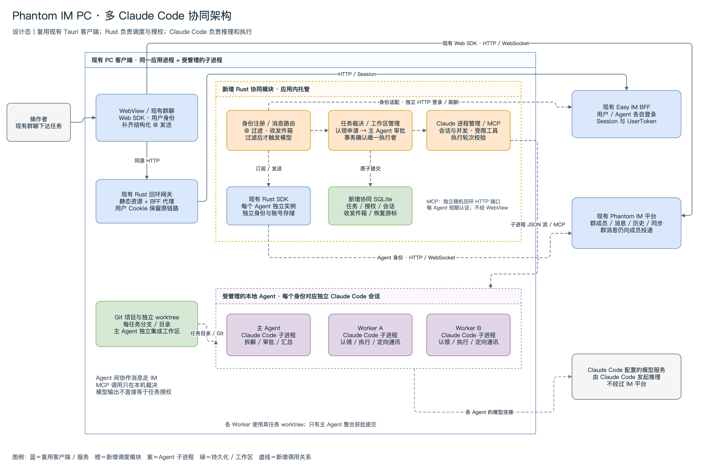

# Phantom IM PC 多 Claude Code Agent 协同产品需求文档（PRD）

> 版本：v0.1 ｜ 状态：需求草案，供评审、开发拆解和测试设计使用 ｜ 更新日期：2026-11-17
>
> 适用分支：`feature-agent-cc`。本文件描述待开发的产品能力，不表示功能已经实现或通过验收。

| 项目 | 说明 |
| --- | --- |
| 产品定位 | 在现有 Phantom IM PC 群聊中组织本地多个 Claude Code Agent 完成开发任务 |
| 需求来源 | 已确认的协作方式及 [技术方案](design.md) |
| 使用对象 | 产品、客户端/Rust 开发、SDK/BFF 开发、测试，以及后续负责实现的编码 Agent |
| 需求编号 | `ACC-FR-*` 为功能需求，`ACC-NFR-*` 为非功能需求，`ACC-AC-*` 为验收场景 |
| 文档职责 | 本文定义范围、产品规则与验收结果；技术方案解释组件、通讯和接口实现 |
| 变更原则 | 开发不得自行扩大广播、权限、任务执行权或自动恢复范围；发现与方案冲突时先记录并同步需求决策 |

## 1. 背景与目标

### 1.1 背景

用户需要让多个本地 Claude Code Agent 参与同一项目，又不希望在多个终端间反复转发任务、同步进度和手工汇总结果。若所有群消息都交给每个 Agent 推理，会产生无关上下文、重复响应和额外 Token 消耗；若缺少任务认领裁决，还会出现多人重复执行、相互覆盖代码和结果无法追踪的问题。

产品应复用现有 IM 群聊作为用户和 Agent 的协作入口，复用 PC 客户端承载本地执行管理，使任务从下达到汇总具有明确负责人、状态和证据。

### 1.2 产品目标

1. 用户在一个现有群聊中发布目标、查看认领与执行进度、处理阻塞，并获得主 Agent 的汇总。
2. 主 Agent 拆解任务、审批认领、协调依赖和验收结果；Worker 只执行已获批的任务。
3. Agent 可以定向 @其他 Agent 通讯；消息先在本地路由，再决定是否触发模型推理。
4. 通过独立工作区、可靠状态记录和可控恢复，避免并发覆盖和重复执行。
5. 记录实际推理触发与可获得的 Token 使用量，为后续评估成本提供证据。

### 1.3 成功标准

以“一名操作者、一个主 Agent、两个 Worker、一个项目、一个群”完成全流程：下达需求 → 拆解 → 认领申请 → 主 Agent 审批 → 并行执行 → 定向问答 → 结果提交 → 审阅整合 → 群内汇总。

成功必须同时满足任务完成、唯一执行权、定向推理和验证证据要求。不能仅凭群消息收发正常、模型能启动或调用次数降低判断产品交付成功；本版本不承诺未经实测的 Token 节省比例。

## 2. 用户、角色与术语

| 角色/术语 | 定义与职责 |
| --- | --- |
| 操作者 | 在项目配置中明确授权的真人 IM 用户；发布目标、控制协同启停、处理授权和阻塞，可显式干预审批、取消或恢复任务 |
| 主 Agent | 一个独立 IM 身份及 Claude Code 逻辑角色；理解目标、建立任务、选择候选、审批认领、审阅结果并汇总 |
| Worker | 一个独立 IM 身份及 Claude Code 逻辑角色；申请任务、执行获批工作、定向协作和提交结果 |
| 协同运行时 | 现有 PC 客户端 Rust 后端的新增能力；负责身份、消息路由、任务状态裁决、会话、工作区及恢复，不是另一个模型角色 |
| Agent 身份 | 注册的逻辑名称与真实 IM 用户 ID 的绑定；昵称或正文中的自我声明不能替代实际身份 |
| 任务 | 有唯一 ID、目标、范围、验收条件、负责人和状态的最小可跟踪工作单元 |
| 认领申请 | Worker 表达执行意愿，不等于已经获得执行权 |
| 执行轮次 | 一次有效执行授权的标识；取消或重新分配后旧轮次失效，用于拒绝迟到结果 |
| 收件 | 消息进入 Agent 的本地收件记录；不必然进入 Claude 上下文 |
| 推理触发 | 一条或一批有效输入被实际提交给目标 Claude Code 会话；模型内部的多次调用另行计量 |
| worktree | 每任务独立分支和工作目录；用于代码隔离，不等同于操作系统安全沙箱 |

### 2.1 权限矩阵

| 操作 | 操作者 | 主 Agent | Worker | 运行时 |
| --- | --- | --- | --- | --- |
| 配置项目、身份和凭据引用 | 本地配置 | 不允许自行修改 | 不允许 | 校验配置，不自行扩大授权 |
| 启停协同、查询状态 | 允许 | 查询，不自行启停应用 | 查询自身授权范围 | 校验并执行控制 |
| 发布目标、提出补充要求 | 允许 | 分解并创建任务 | 可反馈或建议 | 路由与记录 |
| 创建任务、指定候选、登记依赖 | 提交需求，由主 Agent 处理 | 允许 | 不允许擅自新增正式任务 | 校验并保存 |
| 申请认领 | 不适用 | 不代替 Worker 冒名申请 | 被邀请者允许 | 记录申请 |
| 审批/重新分配 | 显式干预允许 | 允许 | 不允许 | 原子确认唯一执行者 |
| 执行任务、提交结果 | 不适用 | 在独立集成工作区审阅整合 | 仅当前获批任务 | 校验身份与执行轮次 |
| 验收结果、退回返工 | 提出反馈 | 允许 | 不允许自验收 | 记录验收状态 |
| 取消/恢复任务 | 允许 | 允许 | 报告阻塞，不自授新轮次 | 使旧授权失效、核对恢复条件 |
| 推送、合入目标分支、发布 | 依既有授权决定 | 仅在已有相应授权时执行 | 默认不允许 | 不因任务完成自动扩大权限 |

未注册成员可以按现有 IM 规则聊天，但不能因此操纵协同运行时。被 @也不代表被授权创建任务、执行代码或审批。

## 3. 版本范围与已确定规则

### 3.1 首版范围

- 复用现有 Tauri PC 客户端、现有 Web 群聊页面、现有 BFF 与 Phantom IM 服务；PC Rust 后端新增协同能力并接入现有 Rust SDK。
- 一台 PC 管理一个启用的协同项目，绑定一个群，一个主 Agent 和多个本地 Worker；同群只有一个权威运行时。
- PC 统一管理 Claude Code 会话和进程；操作者预先准备账号、群成员关系及本机项目。
- 支持群聊任务下达、结构化 @、申请认领与审批、任务执行、定向问答、结果审阅及汇总。
- 每任务独立 worktree；包含取消、阻塞、断线补齐、异常退出和明确恢复。
- 首轮运行验收以 macOS 为先；Windows/Linux 的协同能力必须在各自原生环境另行验收，不能沿用普通 PC 客户端的历史验收结论。

### 3.2 已确认的产品规则

| 决策 | 必须保持的行为 |
| --- | --- |
| 复用 PC 客户端 | 不另建独立产品客户端；本地执行管理由 PC Rust 后端承担 |
| 仅使用现有群聊 | 不新增任务看板；群聊展示需求、认领、审批、状态、阻塞与结果 |
| 统一管理会话 | 不要求操作者手动管理多个终端；Claude Code 由 PC 启动和管理 |
| 主 Agent 审批 | Worker 申请后等待，未获批不得开始执行 |
| 每任务独立 worktree | Worker 互不共享可写工作目录，主 Agent 使用独立集成目录 |
| 定向通讯 | @一个或多个 Agent 时，只向目标 Agent 提交推理输入 |
| 无 @消息 | 全部 Agent 本地收件，默认只有主 Agent 推理 |
| 显式 @全体 | 才触发全员推理；常规协同尽量避免 |

### 3.3 不纳入首版

远程 Worker、多台 PC 联合调度、跨群迁移、主节点自动选举、自动注册账号、独立管理后台、任务看板、自动发布和默认绕过 Claude Code 权限控制，均不纳入本次开发。首版也不承诺托盘驻留或关窗后继续执行。

本地项目配置先采用应用私有配置文件及凭据引用；可视化配置界面属于后续增强，不作为新增看板的理由。

## 4. 用户场景与主流程

### 4.1 用户故事

| 编号 | 用户故事 | 完成标志 |
| --- | --- | --- |
| US-01 | 作为操作者，我希望在群中描述目标，而不用逐一给多个终端分配任务 | 主 Agent 输出可追踪的任务及候选安排 |
| US-02 | 作为 Worker，我希望申请适合自己的工作并在明确获批后开工 | 可查询自己的申请与有效执行权，未获批不执行 |
| US-03 | 作为 Worker，我希望只 @相关 Agent 解决问题 | 目标收到问题，其他 Agent 没有被注入该段问答 |
| US-04 | 作为操作者，我希望随时知道谁在做什么、为什么阻塞 | 群内状态查询返回负责人、状态和可处理原因 |
| US-05 | 作为主 Agent，我希望拿到可核对的提交和测试证据再汇总 | 每项结果均能定位任务、执行轮次、提交及验证记录 |
| US-06 | 作为操作者，我希望异常退出后不丢任务，也不重复执行危险操作 | 重启恢复记录，受影响任务等待明确恢复 |

### 4.2 首次配置与启用

1. 操作者准备可用的 BFF/IM 服务、本地 Claude Code、Git 仓库和专用群。
2. 准备主 Agent 和 Worker 的独立账号，将所有身份加入绑定群；待审批的邀请不视为已入群。
3. 在应用私有配置中填写项目、群、操作者、Agent 映射、凭据引用和执行限制。
4. PC 检查配置、实际登录身份、群成员状态、Claude Code 能力、目录权限及项目基线，输出明确检查结果。
5. 校验通过后启用项目，在群中定向给操作者发送就绪摘要；若某项失败，指出原因，不启动未授权任务。
6. 记录启用基线，旧群历史不自动变成新任务。操作者可在已有项目的控制监听可用时使用群命令启动或停止执行。

### 4.3 一主两 Worker 的完整任务流程

1. 操作者 @主 Agent发布目标；无 @发布时也只触发主 Agent。
2. 主 Agent澄清缺失的目标/验收条件；信息充分后创建任务，标明范围、依赖与验收。
3. 主 Agent定向邀请 Worker A/B 认领，Worker 只提交申请。
4. 主 Agent审批；运行时确认唯一执行者，准备工作区，并将授权结果通知获批 Worker。
5. Worker 在各自 worktree 执行；并行任务应无阻止启动的硬依赖。存在前置任务时须先满足依赖。
6. B 如需接口约定，定向 @A；A 定向 @B 回复。主 Agent不自动接收完整问答上下文。
7. Worker 提交结果和实际验证证据；主 Agent审阅，必要时退回返工。
8. 主 Agent在独立集成工作区整合获批提交并验证，定向 @操作者汇总完成、失败和遗留事项。

### 4.4 架构阅读辅助

该图来自现有设计稿，仅帮助理解承载关系，不表示功能已上线。另见 [任务协作时序图](diagrams/task-sequence.png)、[消息路由与生命周期图](diagrams/routing-lifecycle.png) 和 [三页可编辑 draw.io 图稿](diagrams/agent-collaboration.drawio)。详细组件与通讯方式以 [技术方案](design.md) 为实施参考。

## 5. 功能需求清单

P0 表示首版必须完成且纳入验收。以下需求均为 P0；开发阶段可以分批实现，但阶段原型不得当作完整首版交付。

### 5.1 项目、身份和启停

| 编号 | 需求 | 产品规则 |
| --- | --- | --- |
| ACC-FR-001 | 本地项目配置 | 支持项目标识、仓库目录、绑定群、操作者白名单、主 Agent/Worker、凭据引用、Claude 路径及执行限制；配置缺失/冲突时指出具体项，不自动推断身份 |
| ACC-FR-002 | 启用前检查 | 检查服务可用性、实际登录身份、群成员关系、Claude 安装与适配能力、Git/目录/基线；检查失败的项目不能开始任务执行 |
| ACC-FR-003 | Agent 注册与识别 | 主 Agent 与各 Worker 为独立真实 IM 身份，逻辑别名唯一、身份不可重复占用；能查询能力、在线/可用情况和当前任务，不以昵称作为授权依据 |
| ACC-FR-004 | 独立认证与凭据更新 | 用户和各 Agent 的登录会话、凭据相互隔离；Token 到期按正常认证流程更新，失败时提示重新登录，不能借用其他身份继续 |
| ACC-FR-005 | 协同启停 | 支持已配置项目的启动、停止与状态查询；停止后不启动新推理，取消当前回合并将未完成执行任务置为可恢复 BLOCKED，保留最小控制监听；本地禁用或应用退出则关闭连接 |
| ACC-FR-006 | 身份和角色授权 | 依实际群、发送人、注册身份和角色执行权限矩阵；未授权群成员、伪昵称或正文声明不能创建授权或控制进程 |

### 5.2 任务建立、认领与调度

| 编号 | 需求 | 产品规则 |
| --- | --- | --- |
| ACC-FR-007 | 需求接收与任务拆解 | 支持自然语言目标；主 Agent建立有 ID、范围、验收和依赖的任务，任务与原始需求关联，拆解结果在群里可追踪 |
| ACC-FR-008 | 信息不足时澄清 | 目标、验收、权限或关键项目输入缺失时，主 Agent定向询问操作者并暂停相关任务启动，不臆造决定；无关任务可以继续 |
| ACC-FR-009 | 任务依赖控制 | 登记前置任务并阻止未满足依赖的任务执行；拒绝不存在的依赖和循环依赖并说明原因；返工影响下游时重新核对启动条件 |
| ACC-FR-010 | 定向邀请候选 | 主 Agent按能力选择已注册 Worker 并定向邀请；未受邀 Agent不因任务开放自动参与推理，不用全员广播制造竞争 |
| ACC-FR-011 | 申请认领 | 被邀请 Worker 可提交申请与简短理由；多名候选可同时处于待审批，申请本身不赋予代码读写、worktree 或执行权 |
| ACC-FR-012 | 审批与唯一执行者 | 主 Agent或显式干预的操作者审批；同任务只有一个有效执行者，并发/重复审批不产生重复授权；冲突返回当前状态供重新决策 |
| ACC-FR-013 | 受控调度 | 授权、依赖、工作区均有效才开工；每 Worker 同时最多一个执行任务；默认最多两个 Worker 推理，并为主 Agent预留独立名额 |

### 5.3 群消息与 Token 控制

| 编号 | 需求 | 产品规则 |
| --- | --- | --- |
| ACC-FR-014 | 原生群成员 @ | 现有群聊支持选择一个/多个成员及 @全体，正文和结构化 mentions 一致；删除 @同步删除目标；普通 `@昵称` 文本不自动获得路由效力 |
| ACC-FR-015 | 确定性消息路由 | 先在本地校验与路由，后进入模型；定向只触发目标，无 @全部收件但仅主 Agent推理，显式 @全体才全员推理；无效目标不能回退为广播 |
| ACC-FR-016 | Agent 定向通讯 | Agent 可在群内向明确目标发问/答复，携带任务与关联信息；答复定向返回提问者；主 Agent不自动加入每次问答 |
| ACC-FR-017 | 避免循环与重复唤醒 | 自身回显、重复投递、历史状态、纯回执和状态通知不重复触发推理；同机其他目标 Agent的有效收件不能因“本机发送”被全局丢弃；关联问答达到上限时停止循环并报告 |
| ACC-FR-018 | 最小必要上下文 | 仅注入目标任务、相关问答、摘要和必要产物；Worker 对无 @消息的收件不会在后续自动补喂；不转发完整群历史、其他会话或逐 token 输出 |

### 5.4 执行、结果与用户反馈

| 编号 | 需求 | 产品规则 |
| --- | --- | --- |
| ACC-FR-019 | 独立任务工作区 | 从已记录干净基线为获批任务创建独立分支/worktree，记录负责人和基线；失败或目录冲突时阻塞，不共享其他任务可写目录或覆盖用户改动 |
| ACC-FR-020 | Claude 会话管理 | PC 管理进程和任务会话，保持同 Agent 推理串行；同任务可恢复会话，新任务不静默继承旧任务上下文；申请阶段只开放必要协同能力 |
| ACC-FR-021 | 群内状态与控制 | 通过现有群聊的 `/cc` 命令查询 Agent、任务、负责人、阻塞原因及执行状态；合法控制命令由程序处理，不依赖模型理解；错误命令返回帮助 |
| ACC-FR-022 | 结构化结果提交 | 当前执行者提交任务/轮次、摘要、提交 SHA、修改范围、实际验证、未验证项和遗留问题；群里显示摘要，长日志保留受控引用；不能把未运行测试记为通过 |
| ACC-FR-023 | 结果验收与返工 | 主 Agent审阅当前轮次结果，接受后才记完成；退回时明确问题和验收条件，经新有效授权返工，不能让 Worker 自行验收或沿旧授权继续写入 |
| ACC-FR-024 | 整合与最终汇总 | 主 Agent在独立集成目录核对并整合提交、处理冲突、记录验证，向操作者汇总完成/失败/遗留；完成任务不自动推送、合入目标分支或发布 |

### 5.5 可靠性、边界与兼容

| 编号 | 需求 | 产品规则 |
| --- | --- | --- |
| ACC-FR-025 | 取消与旧结果隔离 | 操作者/主 Agent可取消任务；先使旧授权失效，再停止执行；旧轮次完成/消息不能覆盖当前状态，取消不删除未提交产物 |
| ACC-FR-026 | 退出与明确恢复 | 应用退出停止调度并保存状态；异常退出后核对进程/会话/worktree，将受影响任务置为待恢复，不自动重复副作用操作或自动改派 |
| ACC-FR-027 | 消息补齐与幂等 | 断线、事件溢出、发送确认丢失、重复消息后可补齐并核对；同一有效逻辑事件不会重复创建任务、授权、执行或提交结果；区分排队、平台确认与业务完成 |
| ACC-FR-028 | 阻塞、权限与资源限制 | 认证失败、权限请求、超时、队列/预算限制和必要依赖故障均有可定位原因及处理方式；不静默丢消息，不自动扩大预算或绕过授权 |
| ACC-FR-029 | 本地执行与数据保护 | 本地控制与 Agent 工具分别鉴权，只开放角色允许的操作；消息不直接拼接 shell，不向群、日志或仓库存储凭据；worktree 不被描述为安全沙箱 |
| ACC-FR-030 | 可追踪性与消耗记录 | 能按需求/任务/Agent/轮次追踪消息、审批、状态、执行和结果；记录实际推理触发、过滤、重试和可获取 usage，缺失 Token/费用数据标为未知 |
| ACC-FR-031 | 首次启用与历史边界 | 记录启用基线，不把整个旧群历史自动当新任务；重启按持久化进度补齐未处理内容；历史导入须由操作者明确选择 |
| ACC-FR-032 | 保持普通 IM 可用 | 不启用协同时维持普通 PC 聊天链路；协同执行故障不导致群消息页面不可用；普通 Web 客户端不获得本机执行入口 |

## 6. 关键业务规则

### 6.1 消息收件与推理矩阵

本表适用于已授权来源的普通业务消息；控制事件先按身份、任务和角色校验，不将每条状态事件当自然语言输入。

| 输入 | 本地逻辑收件人 | 推理输入目标 | 额外约束 |
| --- | --- | --- | --- |
| @主 Agent | 主 Agent | 主 Agent | 只处理相关目标 |
| @Worker A | A | A | 正在执行时排队，不并发恢复同一会话 |
| @A 与 @B | A、B | A、B | 每个目标一次有效投递 |
| 无 @ | 所有 Agent | 仅主 Agent | Worker 收件标记为未注入，不自动追加上下文 |
| 显式 @全体或授权广播 | 所有 Agent | 所有 Agent | 由操作者显式发起，不用于常规回执 |
| @操作者的结果汇总 | 操作者 | 无 Agent 因该消息自动推理 | 其他群成员仍能看到 |
| 状态回执/自身回显/已处理事件 | 状态记录或去重 | 无额外推理 | 任务待审批/待审阅等需要判断的通知除外 |
| 无效目标或未知身份的控制请求 | 诊断/拒绝记录 | 不回退到任何默认广播 | 返回可理解的原因 |

@控制模型触发，不构成群消息保密。Agent 工具必须明确指定收件人；未注册成员对运行时的请求不因无 @而获得主 Agent任务权限。

### 6.2 任务内容与证据

创建正式任务至少需要任务 ID、原始需求引用、标题/目标、范围、可检查验收条件、候选及依赖；执行后补充负责人、当前执行轮次、状态、基线与工作区。缺少关键输入时保留草案或阻塞，不以模型猜测补齐授权。

结果至少需要任务和当前执行轮次、摘要、产物及提交引用、实际测试/检查命令和结果、未验证项、遗留问题。不能用进程退出码 0 代替业务验收，也不能把“消息已发出”当作“主 Agent 已验收”。

### 6.3 任务状态

| 状态 | 产品含义 | 进入/离开规则 |
| --- | --- | --- |
| DRAFT 待分配 | 任务草案已建立 | 补齐范围与验收后开放认领，或取消 |
| OPEN 开放认领 | 候选可申请 | 首个有效申请进入待审批；无申请时保持开放，不自动随机派人 |
| CLAIM_PENDING 待审批 | 至少一个有效申请 | 仍接受其他候选申请；审批后唯一分配，全部撤回后可回到 OPEN |
| ASSIGNED 已分配 | 执行者已原子确认 | 工作区、依赖、执行资源就绪后进入 RUNNING，否则等待或阻塞 |
| RUNNING 执行中 | 有效执行者正在工作 | 可提交结果、阻塞、失败或取消 |
| REVIEW_PENDING 待验收 | 当前轮次结果等待主 Agent审阅 | 接受进入 DONE；退回时附反馈并重新开放/授权，不继续使用旧轮次 |
| DONE 已完成 | 主 Agent验收完成 | 只读；追加需求新建任务，不等于已发布 |
| BLOCKED 阻塞 | 有需处理的权限/资源/依赖/恢复问题 | 保留原因及中断前阶段；明确处理后重新校验，恢复到合法阶段 |
| FAILED 失败 | 当前执行已不可继续 | 主 Agent显式重开并生成有效新轮次，或取消 |
| CANCELLED 已取消 | 当前任务终止 | 终态；新增需求另建任务，旧结果只用于审计 |

Worker、任务与执行轮次必须匹配。重新分配、返工或取消须使旧授权失效；原执行进程未确认停止前不允许新 Worker 开始写入同一任务。

### 6.4 并发与默认限制

下列数值沿用技术方案，作为 v0.1 可配置默认值；不代表已测得的系统上限或性能承诺。

| 项目 | 默认规则 |
| --- | --- |
| 项目与群 | 一台 PC 一个启用项目，一个绑定群，一个权威运行时 |
| 主 Agent | 一个，预留独立推理名额，不被 Worker 占满 |
| Worker | 默认最多两个 Worker 同时推理；每 Worker 同时最多一个执行任务 |
| Agent 推理 | 同一 Agent 的回合串行，忙碌时进入有界队列 |
| 定向问答 | 同一关联对话默认最多 4 次 Agent 间发送，达到上限后上报主 Agent；不是 4 轮双向共 8 条 |
| 群消息摘要 | 默认不超过 1000 Unicode 码点；整条消息仍须符合 SDK 现有限制 |
| 退出保存 | 最多 10 秒进行有界保存/关闭；超时后终止遗留子进程树并记录结果 |
| Token/金额预算 | 不预设未经确认的金额和价格；配置受支持的预算后触顶必须阻塞，不自动提高 |

队列满应保留消息或给出明确可恢复失败状态，不将拒绝静默伪装为成功。运行时应在开发设计中给出有限队列与溢出策略，产品验收核对无静默丢失和无无限制进程增长。

### 6.5 群内控制命令

| 命令 | 允许调用者 | 预期反馈 |
| --- | --- | --- |
| `/cc start` | 已授权操作者 | 已配置项目的检查/启动结果；首次配置缺失时提示在本地配置，不从群里收集密码 |
| `/cc stop` | 已授权操作者 | 停止新推理、处理当前回合、保留控制监听的结果；中断任务可查询且不伪报完成 |
| `/cc agents` | 已授权操作者 | 逻辑名、角色、真实身份引用、可用情况、当前任务 |
| `/cc status` | 已授权操作者 | 启停状态及任务 ID、负责人、任务状态、阻塞与必要错误 |
| `/cc approve <任务ID> <Worker别名>` | 已授权操作者 | 显式审批干预结果；仍要求有效申请和唯一执行者校验 |
| `/cc cancel <任务ID>` | 已授权操作者 | 是否取消成功、旧轮次是否失效及产物保留情况 |
| `/cc resume <任务ID>` | 已授权操作者 | 恢复前置检查及结果；不代表允许跳过具体工具授权 |
| `/cc broadcast <内容>` | 已授权操作者 | 明确的全部 Agent 推理请求；失败不能变成未受控重试 |

`/cc start` 只启用运行时调度，不自动恢复已有 BLOCKED 任务；中断任务仍须明确 `/cc resume` 或主 Agent的相应授权恢复操作。

主 Agent与 Worker 通过授权工具完成其角色允许的业务操作，不通过伪造真人命令获得操作者权限。无效命令仅返回帮助和原因，不触发全员推理。群里普通“同意”不等于批准任意后续命令。

## 7. 异常与边界处理

| 场景 | 用户可观察的要求 | 禁止行为 |
| --- | --- | --- |
| 多人认领同一任务 | 显示待审批及最终唯一执行者；未获批者等待 | 谁先发消息谁就先编码 |
| 重复审批或状态版本冲突 | 返回已处理或当前状态，保留审计 | 二次启动进程、生成两个有效授权 |
| Worker 忙碌 | 保留定向消息并说明排队情况 | 同一会话并发恢复或静默丢消息 |
| 输入缺失、依赖不满足 | 定向说明缺什么、由谁处理 | 猜测项目路径、验收或执行权限 |
| Agent 离群/账号不匹配 | 拒绝相应控制或新调度，提示身份问题 | 按相同昵称继续执行 |
| IM 断线/事件溢出 | 显示通讯问题并补齐、去重；新授权调度在必要同步完成后继续 | 因重放重复执行任务 |
| 已发送但确认丢失 | 可查询投递状态，幂等重试并核对 | 换新事件反复创建相同任务 |
| Token 到期/登录失败 | 更新自身凭据或请求重新登录，展示原因 | 借用操作者/其他 Agent Token |
| Claude 崩溃/超时/权限请求 | 保存可获取进度，任务 BLOCKED/FAILED，说明下一步 | 自动从头重做副作用操作或跳过权限 |
| PC 正常退出/异常退出 | 保存状态，重启后核对进程和工作区，中断任务等待明确恢复 | 旧进程还活着就改派另一个 Worker |
| 取消后收到迟到结果 | 旧结果保留审计、拒绝改变当前状态 | 把已取消或新轮次任务改成完成 |
| worktree 冲突/用户未提交改动 | 保留文件，提示负责人处理 | 强制清理用户目录或复用其他任务工作区 |
| 合并冲突/验收失败 | 主 Agent反馈问题、登记返工或失败 | 静默丢弃某个 Worker 修改或虚报测试通过 |
| 预算或问答上限触发 | 暂停新推理并定向报告，等待明确处理 | 自动抬高预算或无界互相唤醒 |

## 8. 非功能需求

| 编号 | 要求 | 可检查标准 |
| --- | --- | --- |
| ACC-NFR-001 | 确定性与一致性 | 路由、授权、去重和取消轮次由程序判断；即使模型提出重复/越权操作也只有一个有效状态变化。验收：ACC-AC-006、ACC-AC-012、ACC-AC-015、ACC-AC-025 |
| ACC-NFR-002 | 可恢复性 | 崩溃与断线后可还原任务、负责人、收件进度、会话和产物引用；恢复不依赖模型猜测历史。验收：ACC-AC-026、ACC-AC-027、ACC-AC-031 |
| ACC-NFR-003 | 权限与秘密保护 | IM 身份、MCP 工具及桌面控制入口各自鉴权；凭据不进入项目仓库、群消息或可公开报告。验收：ACC-AC-004、ACC-AC-006、ACC-AC-029 |
| ACC-NFR-004 | 资源有界 | 遵守并发、队列、回合和退出约束；空闲 Agent 不做模型轮询，不因大量历史消息无限启动进程。验收：ACC-AC-013、ACC-AC-017、ACC-AC-026、ACC-AC-028 |
| ACC-NFR-005 | 可理解反馈 | 群摘要提供任务 ID、当前状态、负责人、原因和下一步，区分排队、平台确认、执行和验收。验收：ACC-AC-021、ACC-AC-022、ACC-AC-027 |
| ACC-NFR-006 | 可观测与真实计量 | 能核对消息路由与实际推理触发；usage 缺失标为未知，不能用字符数冒充计费 Token。验收：ACC-AC-015、ACC-AC-030 |
| ACC-NFR-007 | 平台与普通聊天兼容 | 协同关闭时普通 IM 行为可回归；各操作系统必须有原生验证证据，不以单平台通过代替跨平台验收。验收：ACC-AC-032、ACC-AC-033，在各拟发布平台分别执行 |

响应时延、CPU/内存和成本的定量目标尚无实测基线，本版要求记录实际数据并在发布评审给出结果，不编造毫秒级 SLA 或固定节省率。既有普通 IM 性能和安全要求继续适用。

## 9. 验收场景与需求追踪

下列场景是待实现后的验收要求，不是本 PRD 编写时已经执行的测试。Given 为前置条件，When 为操作，Then 为必须观察到的结果。每个功能需求至少关联一个场景。

| 场景 | 需求 | Given / When / Then |
| --- | --- | --- |
| ACC-AC-001 | ACC-FR-001 | Given 缺失仓库或重复身份配置；When 启用项目；Then 定位错误项、不猜测替代值、无任务进程启动 |
| ACC-AC-002 | ACC-FR-002 | Given CLI 不可用、Agent 未实际入群或基线不满足；When 启用检查；Then 对应检查失败且执行被阻止，修正后可重新检查 |
| ACC-AC-003 | ACC-FR-003 | Given 一主两 Worker 独立账号；When 查询 Agent；Then 每项身份/角色唯一且匹配真实登录结果，重名昵称不改变绑定 |
| ACC-AC-004 | ACC-FR-004 | Given A 的 Token 到期而 B 正常；When A 恢复认证；Then 仅使用 A 的正常会话更新，B 和操作者凭据不被替换或泄露 |
| ACC-AC-005 | ACC-FR-005 | Given 项目正在运行；When 操作者 stop 后再 start；Then 不再启动新回合、当前回合被取消且未完成任务置为 BLOCKED、控制监听可用；start 只恢复调度，中断任务需另行明确恢复 |
| ACC-AC-006 | ACC-FR-006 | Given 未授权群成员或 Worker 冒充主 Agent；When 提交审批/取消/启停请求；Then 拒绝越权且任务/进程状态不变 |
| ACC-AC-007 | ACC-FR-007 | Given 已启用且目标充分；When 操作者 @主 Agent下达目标；Then 形成关联原始需求、范围和验收的任务并在群里可追踪 |
| ACC-AC-008 | ACC-FR-008 | Given 缺少关键验收条件或执行权限；When 主 Agent接收目标；Then 定向澄清且相关任务不执行，不臆造答案 |
| ACC-AC-009 | ACC-FR-009 | Given T2 硬依赖未完成的 T1；When T2 获批或配置循环依赖；Then T2 不开工、循环被拒绝；T1 验收后重新校验才可启动 |
| ACC-AC-010 | ACC-FR-010 | Given 仅 A 被邀请；When 开放认领；Then 邀请只进入 A，B 没有该邀请引起的推理输入 |
| ACC-AC-011 | ACC-FR-011 | Given A/B 均被邀请；When 两人申请；Then 两项申请都可待审批，两人均未获得任务 worktree 或代码执行授权 |
| ACC-AC-012 | ACC-FR-012 | Given 同一任务有两个申请；When 并发批准 A/B 并重放成功审批；Then 只有一个有效执行者且无重复授权/任务执行 |
| ACC-AC-013 | ACC-FR-013 | Given 两个 Worker 名额已占用；When 新授权排队且主 Agent有审批工作；Then Worker 不超限、单 Worker 不并行执行两任务、主 Agent仍可处理 |
| ACC-AC-014 | ACC-FR-014 | Given 输入区选中 A/B；When 删除 A 的 @后发送；Then 仅 B 留在结构化 mentions；相同昵称的普通文本不冒充真实 @ |
| ACC-AC-015 | ACC-FR-015 | Given 一主两 Worker 空闲且消息来源有效；When 分别发送 @A、@A+B、无 @、@全体；Then 分别产生 1、2、1、3 个目标推理输入，无 @的两 Worker 收件标为未注入；无效目标不广播 |
| ACC-AC-016 | ACC-FR-016 | Given A 向 B 定向提问；When B 定向回复 A；Then 仅 A/B 相关会话收到输入，主 Agent不自动获取完整问答 |
| ACC-AC-017 | ACC-FR-017 | Given 消息回显、同事件多份投递及一段关联问答；When 重放事件并尝试第 5 次发送；Then 不重复触发，超限上报；同机另一目标的首次有效收件仍可正常处理 |
| ACC-AC-018 | ACC-FR-018 | Given Worker 已记录无 @消息和其他任务历史；When 收到自己的新任务；Then 输入只含获准相关上下文，不自动追加这些记录 |
| ACC-AC-019 | ACC-FR-019 | Given 两项任务获批且存在用户未提交文件；When 准备工作区；Then 独立 worktree/分支可定位，冲突阻塞，用户文件不被清理或覆盖 |
| ACC-AC-020 | ACC-FR-020 | Given Worker 在同任务内收到后续输入；When 恢复会话及切换到新任务；Then 同任务串行恢复，新任务使用独立上下文；未获批申请阶段无代码执行权限 |
| ACC-AC-021 | ACC-FR-021 | Given 有执行和阻塞任务；When 查询状态或输入无效命令；Then 返回负责人/阶段/原因或帮助，命令解析不消耗模型推理 |
| ACC-AC-022 | ACC-FR-022 | Given 当前 Worker 完成工作但有测试未运行；When 提交结果；Then 产物、SHA、实际验证和未验证项齐备，未运行不能显示通过 |
| ACC-AC-023 | ACC-FR-023 | Given 结果不满足验收；When 主 Agent退回后 Worker 尝试用旧授权继续写入；Then 反馈可见、旧授权无效，经新批准才能返工，完成状态只由验收产生 |
| ACC-AC-024 | ACC-FR-024 | Given 两项结果待整合且其中有冲突；When 主 Agent整合汇总；Then 在独立目录记录冲突/处理与验证，向操作者定向汇总，不自动推送或发布 |
| ACC-AC-025 | ACC-FR-025 | Given 执行中任务被取消；When 收到旧轮次完成消息；Then 当前状态不被覆盖、旧结果只留审计、未提交文件仍保留 |
| ACC-AC-026 | ACC-FR-026 | Given 存在执行中任务；When 正常退出或强制结束 PC 后重启；Then 正常退出遵守 10 秒保存窗口并处理遗留进程，重启核对状态且不自动重做副作用操作 |
| ACC-AC-027 | ACC-FR-027 | Given 断线/事件溢出/平台发送成功但确认丢失；When 补齐并重试；Then 有效业务变化不重复，投递状态和完成状态可区分 |
| ACC-AC-028 | ACC-FR-028 | Given 权限请求、超时、队列满或已支持预算触顶；When 调度或执行；Then 有明确阻塞原因/处理方式，不绕过权限、不自动提额、不静默丢任务消息 |
| ACC-AC-029 | ACC-FR-029 | Given 群文本包含 shell 片段、伪控制载荷或其他 Agent身份；When 尝试调用本地能力；Then 消息只作数据、工具按真实身份拒绝越权，秘密不进入公开输出 |
| ACC-AC-030 | ACC-FR-030 | Given 同一任务经历审批/重试/恢复；When 查询诊断；Then 可关联任务、消息、Agent、轮次与实际推理；缺失 usage 显示未知而非推算值 |
| ACC-AC-031 | ACC-FR-031 | Given 群内已有大量旧任务描述；When 首次启用再重启；Then 首次不自动执行旧消息，重启只补齐未处理范围；导入历史需要明确操作 |
| ACC-AC-032 | ACC-FR-032 | Given 协同未启用或 Claude 执行故障；When 继续普通 PC 群聊并访问普通 Web；Then 聊天可用且 Web 无本机执行权限 |
| ACC-AC-033 | ACC-FR-007、ACC-FR-012、ACC-FR-016、ACC-FR-022、ACC-FR-024 | Given 专用群、一主两 Worker 和独立项目；When 执行第 4.3 节完整流程；Then 群内可还原任务申请、批准、定向问答、证据及最终汇总，运行时记录可核对 |

验收至少包含路由/授权/状态机的确定性测试、受控模型进程测试和真实 IM/Claude 端到端验证。不能以 mock 场景替代真实协作闭环；真实调用使用专用身份和工作目录，报告必须脱敏并记录实际前置条件。

## 10. 分阶段交付与发布门槛

| 阶段 | 交付目标 | 阶段检查 |
| --- | --- | --- |
| M1 接入原型 | PC 承载、配置/预检、一个 Agent独立认证、@路由、Claude 会话/工具调用、有界退出 | 证明关键接口可接通；记录不兼容项，不宣称完整首版 |
| M2 协作闭环 | 一主两 Worker、认领审批、独立 worktree、定向问答、结果与整合汇总 | 运行 ACC-AC-033，同时证明无重复执行和无无关推理 |
| M3 可靠性与首版验收 | 补齐取消、故障恢复、权限、预算/队列、观测和普通聊天回归 | 全部 P0 和非功能要求有验证证据；按目标平台分别形成报告 |

发布前应提供需求编号到实现/测试的映射、真实闭环报告、关键异常报告、目标平台清单和已知限制。未执行项明确标注，不计为通过。项目状态、凭据和测试资料按现有私有知识库规范管理。

## 11. 数据指标与后续需求管理

### 11.1 必须记录的评估数据

- 任务：建立、认领、获批、开始、待验收、完成、返工、失败和取消数量及耗时。
- 路由：收件数、定向/广播数、过滤数、目标推理输入数及排队时间。
- 可靠性：审批冲突、消息重试、恢复次数、迟到结果拒绝和遗留进程处理结果。
- 消耗：Claude 实际提供的输入/输出 Token 与受支持费用信息；未提供的维度标为未知。
- 结果：任务完成率、验收结论和普通聊天回归结果，防止仅优化调用数量而降低交付质量。

对比成本时使用相同任务、上下文范围和完成标准，同时报告实际 usage、推理触发、完成率和延迟。不把“收到但没推理”直接换算成固定 Token 节省金额。

### 11.2 后续拆解规则

1. 以 `ACC-FR-*` 拆解开发项，附对应 `ACC-AC-*`；非功能要求作为相关模块共同约束。
2. 在进入编码前补齐必要技术细节：适配的 Claude CLI 输入输出/授权行为、有限队列策略、受支持预算计量方式、各平台进程树终止方式；技术选型不能改变本 PRD 的业务规则。
3. 产品规则变更先更新 PRD 与验收，再同步技术方案和图稿；不能只在提示词中新增规则。
4. 金额上限、时延 SLA、可支持规模和 Windows/Linux 发布批次，需依据后续实测与发布决策确认；本 PRD 不虚构数值或发布时间。

## 12. 参考文档与版本记录

| 文档 | 用途 |
| --- | --- |
| [协同技术方案](design.md) | 组件职责、通道、事件与接口、恢复设计 |
| [现有 PC 客户端说明](../../../phantom-im/clients/pc/README.md) | Tauri 承载、配置与构建现状 |
| [现有 Rust SDK 说明](../../../phantom-platform/sdks/rust/README.md) | Agent 通讯所复用的 SDK 能力与限制 |
| [设计交付验证记录](verification.md) | 文档/图稿本身的检查；不是功能上线证据 |

| 日期 | 版本 | 内容 |
| --- | --- | --- |
| 2026-11-17 | v0.1 | 从已确认协作方式和技术方案提炼需求、权限、业务规则、32 项功能需求、7 项非功能需求与 33 个验收场景，作为后续开发输入 |
