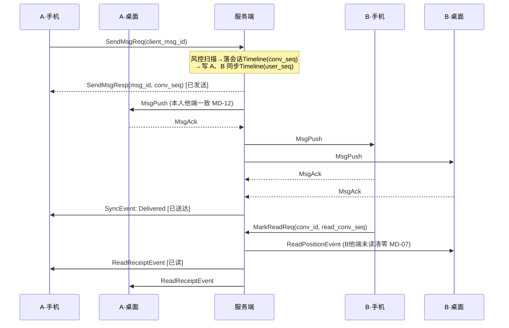
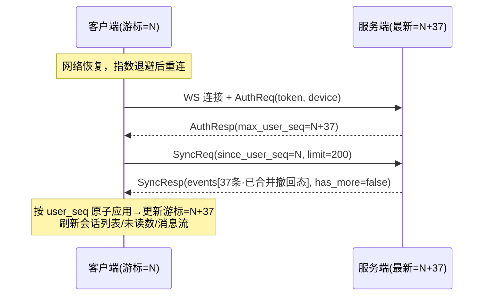

# Phantom IM 通讯协议设计

> 版本：v1.0 ｜ 状态：已评审 ｜ 日期：2026-08-07 ｜ 上游需求：[PRD 文档集](../prd/README.md)

## 0. 设计决策记录

| 决策项 | 结论 | 理由 |
|---|---|---|
| 协议范围 | 完整协议栈（长连接 + HTTP API + 同步机制 + 媒体通道） | 覆盖 PRD 全部功能域的通信需求 |
| 传输层 | WebSocket（WSS）四端统一 | 一套协议栈一套网关，Web 端零适配，MVP 成本最低 |
| 序列化 | 长连接 Protobuf，HTTP API JSON | 实时通道要效率与强 schema；HTTP 要易用易调试 |
| 同步模型 | 双 Timeline 混合模型 | 会话 Timeline 存消息体（不放大存储，支撑永久漫游 MD-03）；用户同步 Timeline 存轻量事件（单游标多端补齐 MD-05，状态事件统一时序 MD-07~13）。微信/钉钉同构 |
| 交付物 | 本文档 + `phantom-platform/contracts/proto/phantom/v1/*.proto` | 文档定义规则，proto 定义可编译的报文契约 |
| 产品定位（v0.2） | IM 开发平台（PaaS）：SDK + OpenAPI 对外，无 C 端账号体系 | 用户身份仅 Phantom ID，注册/登录凭证/隐私/注销由接入方用户体系承担；鉴权改为接入方服务端签发 UserToken（PRD 01 v0.2） |

---

## 1. 总体分层架构

```
┌─────────────────────────────────────────────────────────┐
│        客户端（iOS / Android / Web / 桌面）                │
│  本地存储（消息缓存/游标） + 发送队列 + 同步引擎              │
└────────┬──────────────────┬────────────────┬────────────┘
         │ WSS + Protobuf   │ HTTPS + JSON   │ HTTPS
         ▼                  ▼                ▼
┌──────────────┐   ┌───────────────┐   ┌──────────────┐
│   实时网关     │   │   HTTP API    │   │   媒体服务     │
│  (长连接通道)  │   │   (业务请求)   │   │ (分片上传/CDN) │
└──────┬───────┘   └───────┬───────┘   └──────────────┘
       │                   │
       ▼                   ▼
┌─────────────────────────────────────────┐
│ 会话 Timeline（convSeq，消息体，永久存储）  │
│ 用户同步 Timeline（userSeq，事件引用，30 天）│
│ 多端在线路由表 / 离线推送决策               │
└─────────────────────────────────────────┘
```

### 1.1 通道职责划分

**长连接（WSS）只承载"实时性强、需服务端主动推送"的流量：**

- 消息发送与接收（Send / Push / Ack）
- 同步事件流拉取（Sync）与已读上报（MarkRead）
- 信令：输入状态、在线状态订阅、撤回、App 前后台状态
- 服务端主动通知：被踢下线、强制登出

**HTTP API 承载其余全部请求-响应型业务：**

- 注册登录、验证码、Token 续期、扫码登录
- 资料、隐私设置、关系链、黑名单、群管理
- 会话列表快照、会话状态写入（置顶/免打扰/删除/草稿）
- 历史消息漫游分页、搜索
- 设备管理、推送 Token 注册、举报、数据导出
- 媒体分片上传（下载走 CDN 直链）

**划分原则**：能用 HTTP 的不占长连接。媒体文件本体永不走长连接——先 HTTP 上传拿 `mediaId`，再通过长连接发送只含元数据的消息（对应 03-messaging 4.1 步骤 3）。

---

## 2. 连接层协议

### 2.1 帧格式

WebSocket binary 帧，每帧一个 Protobuf `Envelope`：

```protobuf
message Envelope {
  uint32  version = 1;   // 协议版本，当前为 1
  Command cmd     = 2;   // 指令，见 2.2
  uint64  cid     = 3;   // 客户端请求流水号；响应帧回带；服务端主动推送为 0
  int32   code    = 4;   // 响应码，0 成功；请求帧与推送帧为 0
  bytes   payload = 5;   // cmd 对应的报文体（Protobuf 序列化）
}
```

- 请求-响应配对：客户端每次请求 `cid` 单调递增，服务端响应帧回带同一 `cid`。
- 三类帧：**Req**（客户端→服务端，期待响应）、**Resp**（服务端→客户端，回应 Req）、**Push**（服务端→客户端，`cid=0`，不需响应——`MsgPush` 除外，需回 `MsgAck`）。

### 2.2 指令集（Command）

按功能域分段编号，与 proto 中 `Command` 枚举一致：

| 分段 | 域 | 指令 |
|---|---|---|
| `0x0001~0x00FF` | 连接管理 | `AUTH_REQ/RESP`、`PING/PONG`、`KICK_PUSH`、`LOGOUT_REQ/RESP` |
| `0x0100~0x01FF` | 消息 | `SEND_MSG_REQ/RESP`、`MSG_PUSH`、`MSG_ACK`、`RECALL_MSG_REQ/RESP`、`RECALL_PUSH` |
| `0x0200~0x02FF` | 同步 | `SYNC_REQ/RESP`、`MARK_READ_REQ/RESP`、`READ_RECEIPT_PUSH`、`CONV_DIGEST_REQ/RESP` |
| `0x0300~0x03FF` | 信令 | `TYPING_SIGNAL`、`TYPING_PUSH`、`PRESENCE_SUB_REQ/RESP`、`PRESENCE_UNSUB_REQ`、`PRESENCE_PUSH`、`APP_STATE_REQ/RESP` |

### 2.3 认证握手

连接建立后**首帧必须是 `AuthReq`**，超时（10 秒）未认证服务端主动断开：

```
AuthReq {
  access_token          // UserToken：接入方服务端用 AppSecret 签发的 JWT（6.2）
  device_id             // 客户端生成并持久化的设备唯一标识
  device_type           // MOBILE / DESKTOP / WEB（MD-01 三类设备）
  platform              // ios / android / windows / macos / web
  client_version
  app_id                // 应用标识（AC-01），验签与租户路由依据
  user_id               // Phantom ID，须与 UserToken claims 一致
}
AuthResp {
  server_time           // 服务端时间，供客户端校准时钟偏移
  max_user_seq          // 服务端当前最新 userSeq，客户端据此判断需要同步多少
  heartbeat_interval_s  // 服务端建议的心跳间隔
  burn_after_read       // 应用级阅后即焚配置 { enabled, ttl_seconds }，见 9.1
  read_receipt          // 应用级已读反馈配置 { enabled }，见 4.5
}
```

认证成功后服务端将 `(userId, deviceType, deviceId, connId)` 登记进**多端在线路由表**（07 文档 4.9，详细设计见 [MQ 架构文档第 6 节](2026-08-07-im-mq-architecture-design.md)），并执行在线策略：

- **同类型互踢（MD-02）**：同 `device_type` 已有连接时，向旧连接推 `KickPush{ reason=SAME_TYPE_LOGIN }` 后断开。
- **设备总数上限（MD-18）**：超上限且无同类型可顶替时，`AuthResp` 返回错误码 `2005 DEVICE_LIMIT_EXCEEDED`，拒绝本次连接。

`KickPush.reason` 枚举：`SAME_TYPE_LOGIN`（同端登录顶替）/ `REMOTE_LOGOUT`（远程下线 MD-15 / OpenAPI 强制下线 AC-10）/ `TOKEN_REVOKED`（接入方吊销凭证或禁用用户 AC-06、AppSecret 应急轮换）/ `BANNED`（平台封禁 SEC-08）。收到 `KickPush` 的 SDK **不得自动重连**，须回调宿主 App 并透传 reason，由宿主决定后续（如引导重新获取 UserToken 或退出）。

### 2.4 心跳与在线判定

- 客户端按 `heartbeat_interval_s`（移动端基线 270 秒，可自适应下调）发送 `Ping`，服务端回 `Pong`。
- 服务端连续 **2 个周期**未收到任何上行帧，判定连接失效，摘除路由表记录。
- 路由表在线状态是**离线推送触发**的判定输入（NT-01）：某账号无任何"在线可达"连接时，新消息转入推送流程。

### 2.5 断线重连

1. 客户端检测断开后指数退避重连：`1s, 2s, 4s, ... 上限 60s`，每次叠加 ±30% 随机抖动（避免服务端故障恢复时的重连风暴）。
2. 重连成功 → 重新 `AuthReq` → 比较 `AuthResp.max_user_seq` 与本地游标 → 落后则立即发起 `SyncReq` 增量补齐（MD-05）。
3. 弱网期间本地缓存正常可读（总纲"弱网可用"原则），发送队列中未确认消息按第 3.4 节规则重试。

---

## 3. 核心数据模型与消息收发

### 3.1 标识体系

| 标识 | 生成方 | 作用 |
|---|---|---|
| `client_msg_id` | 客户端（UUID v4） | **幂等去重键**（MSG-16）。服务端按 `(sender_id, client_msg_id)` 去重，重复提交返回首次结果；客户端渲染层按 `msg_id` 去重兜底 |
| `msg_id` | 服务端 | 消息全局唯一 ID，撤回/引用/举报的目标标识 |
| `conv_id` | 规则生成 | 单聊：`si_` + 双方 uid 升序拼接 hash——从任何入口进入同一好友的会话必得同一 `conv_id`（DC-01/02/03）；群聊：`gr_` + groupId |
| `conv_seq` | 服务端（会话内严格递增） | 会话内排序唯一依据（MSG-15），同 `server_time` 时的次级排序键（06 文档边界场景），漫游分页游标 |
| `user_seq` | 服务端（用户全局严格递增） | 同步 Timeline 事件编号，多端增量补齐游标（MD-05/06） |
| `server_time` | 服务端 | 展示时间与撤回窗口判定基准，客户端本地时钟不参与排序（MSG-15） |

### 3.2 消息模型

```protobuf
message Msg {
  string   msg_id;
  string   client_msg_id;
  string   conv_id;
  ConvType conv_type;         // SINGLE / GROUP
  string   sender_id;
  MsgType  msg_type;
  MsgContent content;         // oneof，见 3.3
  int64    conv_seq;
  int64    server_time;       // 毫秒
  string   reply_to_msg_id;   // 引用回复（MSG-13），空 = 非引用
  ReplySnapshot reply_snapshot; // 引用摘要快照（原消息撤回后仍可展示，03 边界"撤回后再引用"）
  repeated string mentions;   // 被 @ 的 userId 列表；含哨兵值 "ALL" 表示 @全体（GC-13/14）
  bool     recalled;          // 同步/漫游下发时已合并撤回态（07 边界"撤回优先"）
}
```

### 3.3 消息类型（MsgType / MsgContent）

| 类型 | 内容要点 | PRD 约束 |
|---|---|---|
| `TEXT` | text（≤5000 字符） | MSG-01 |
| `EMOJI` | 内置表情包 id（Unicode emoji 直接走 TEXT） | MSG-02 |
| `IMAGE` | mediaId、缩略图 URL、原图 URL、宽高、大小 | MSG-03，多张 = 多条独立消息 |
| `VOICE` | mediaId、时长（≤60s） | MSG-04 |
| `VIDEO` | mediaId、封面 URL、时长（≤5min）、大小（≤100MB） | MSG-05 |
| `FILE` | mediaId、文件名、大小（≤500MB）、扩展名 | MSG-06 |
| `LOCATION` | 经纬度、poi 名称、地址（P1） | MSG-07 |
| `CARD` | 名片类型（用户/群）、目标 id、快照昵称头像（P1） | MSG-08 |
| `MERGED` | 合并转发：内嵌 `repeated Msg`（≤100 条，不可嵌套 MERGED） | MSG-12、03 边界 |
| `SYSTEM` | 系统提示（建群/入群/撤回占位/受限投递提示等），模板 id + 参数 | 各文档系统消息 |

大小/时长超限由**客户端发送前拦截**（MSG-17），服务端二次校验兜底。

### 3.4 发送链路

```
用户点击发送
  ├─ 1. 本地生成 client_msg_id，消息入本地队列，UI 立即展示"发送中"
  ├─ 2.（媒体消息）HTTP 分片上传 → 拿 mediaId（见 6.6）
  ├─ 3. WS 发送 SendMsgReq{ client_msg_id, conv_id, msg_type, content, reply_to, mentions }
  ├─ 4a. SendMsgResp{ code=0, msg_id, conv_seq, server_time } → UI 更新"已发送"
  ├─ 4b. code=4xxx（风控拦截/会话失效/禁言/频控）→ UI 置"失败"+ 对应文案
  └─ 4c. 15 秒无响应 → 置"失败"，可手动重发（03 边界"弱网超时判定"）
```

- **重发**：沿用原 `client_msg_id` 重新提交（服务端幂等保证不重复落库），排序沿用首次成功的 `conv_seq`/`server_time`（MSG-10）。自动重试上限 3 次，之后仅手动。
- **受限投递（DC-16/18）**：对方已删除我/拉黑我时，`SendMsgResp` **正常返回成功**（不透露原因），服务端静默不投递、不产生对方 userSeq 事件；随后通过发送方自己的同步 Timeline 下发一条 `RestrictedDeliveryEvent`，客户端据此在会话内插入系统提示气泡，消息状态停留在"已发送"。
- **我方主动受限（DC-15/17）**：我已删除对方/拉黑对方 → 客户端本地拦截不发送（关系状态以本地最新为准，04 边界）；若本地状态过期而发送到达服务端，返回 `3002 NOT_FRIEND` / `3003 IN_MY_BLACKLIST`。
- **消息状态机（MSG-09）**：`SENDING → SENT → DELIVERED → READ`，失败态 `FAILED`。`DELIVERED` 由服务端投递到对方任一在线设备（或对方 sync 拉到）时经发送方同步 Timeline 下发；`READ` 见 4.5。状态只进不退。

### 3.5 接收链路（在线推送 + ACK 必达）

```
服务端收到消息（落会话 Timeline，写各接收者同步 Timeline 引用）
  ├─ 查路由表 → 对每个在线连接推 MsgPush{ msg（完整消息体）, user_seq }
  ├─ 客户端收到 → 按 msg_id 幂等去重 → 落本地库 → 回 MsgAck{ user_seq }
  ├─ 服务端记录该设备 ACK 游标；5 秒未收到 ACK 重推一次
  └─ 仍未 ACK → 放弃在线推送，该事件留在同步 Timeline，由下次 SyncReq 补齐（必达兜底）
```

设备级 ACK 游标即"该设备已确认到的 userSeq"，与 `SyncReq.since_user_seq` 是同一游标——在线推送与离线补拉共用一套进度，不存在两套账。

### 3.6 撤回

1. `RecallMsgReq{ msg_id }` → 服务端校验：归属（本人；群主/管理员扩展权限见群规则）+ 时间窗口（`now - server_time ≤ 120s`，以服务端时钟为准，03 边界）。
2. 通过 → 会话 Timeline 该消息标记 `recalled`，写撤回事件进**所有相关用户**（单聊双方/全部群成员）的同步 Timeline，并向在线设备推 `RecallPush{ msg_id, conv_id, operator_id }`。
3. 超时/重复撤回 → `4003 RECALL_TIMEOUT` / `4004 ALREADY_RECALLED`（多端并发撤回时后到者静默同步，03 边界）。
4. 离线设备经 Sync 拉到的消息已合并撤回态，不会闪现原文（07 边界）。

---

## 4. 双 Timeline 同步与漫游协议（核心）

### 4.1 两条 Timeline 的分工

| | 会话 Timeline | 用户同步 Timeline |
|---|---|---|
| 键 | `(conv_id, conv_seq)` | `(user_id, user_seq)` |
| 内容 | 完整消息体，1 份 | 轻量事件（引用 + 状态变更），每接收者 1 份 |
| 保留 | 永久（MD-03） | 滚动窗口 30 天 |
| 用途 | 历史漫游分页、全量重建 | 多端增量补齐、状态同步 |
| 通道 | HTTP（第 6.4 节） | WS `SyncReq/Resp` |

### 4.2 同步事件类型（SyncEvent）

所有需要多端感知的变更统一进入同步 Timeline，按 `user_seq` 严格排序：

| 事件 | 触发 | 对应需求 |
|---|---|---|
| `NewMessageEvent` | 收/发消息（含本人他端发出，MD-12） | MD-05/06 |
| `RecallEvent` | 消息被撤回 | MD-13 |
| `ReadPositionEvent` | 本人任一端已读位置变更 | MD-07/08 |
| `ReadReceiptEvent` | 单聊对端已读 / 群已读人数变化 | MSG-09 |
| `ConvStateEvent` | 置顶/免打扰/会话删除/标记已读 | MD-09/10、CV-18 |
| `DraftEvent` | 草稿变更（含清空），带编辑时间戳做冲突仲裁 | MD-11、CV 边界 |
| `RelationEvent` | 好友通过/删除/拉黑/解除、申请到达 | REL-06/07 |
| `GroupEvent` | 成员进出/权限变更/禁言/公告/群资料/解散 | GC 系列 |
| `ProfileEvent` | 本人资料/隐私设置变更、好友备注变更 | AC-09/11/12 |
| `RestrictedDeliveryEvent` | 受限投递提示（见 3.4） | DC-16/18 |

`NewMessageEvent` 默认**内联完整消息体**（省一次回捞）；超大内容仅带 `(conv_id, conv_seq, msg_id)` 引用，客户端经漫游接口回捞。

### 4.3 同步流程

```
SyncReq{ since_user_seq, limit=200 }
SyncResp{ events[], max_user_seq, has_more, full_resync=false }
```

1. 触发时机：认证握手后发现落后、收到任何 Push 时发现 userSeq 跳号（乱序/丢包检测）、前后台切换。
2. 客户端循环拉取直到 `has_more=false`，**按 user_seq 顺序原子应用**到本地库，每批持久化游标。
3. 服务端下发前做**事件合并**：同一消息的"新消息 + 撤回"合并为撤回态消息；同一会话多次置顶/取消只保留最终态。减少下发量且天然满足"撤回优先"（07 边界）。
4. 重复事件（重推/重连竞态）按 `user_seq` 幂等丢弃（07 边界"重复推送/乱序"）。

### 4.4 游标过期与全量重建

`since_user_seq` 超出 30 天保留窗口 → `SyncResp{ full_resync=true }`，客户端放弃事件回放，改走 HTTP 全量重建（07 边界"长期未启动"、CV 边界"30 天未打开"）：

1. `GET /conversations?cursor=...` 分页拉会话列表快照（含最后一条消息摘要、未读数、置顶、免打扰、草稿——07 文档 4.8 一并返回，不单独请求）。首屏只拉最近活跃前 N 页（07 边界"会话数巨大"）。
2. 以快照回包中的 `max_user_seq` 重置本地游标。
3. 各会话历史消息不预拉，进入会话时按 4.6 懒加载（MD-04、07 边界"首拉超时"）。

新设备首次登录 = 本地游标为空 = 同一条全量重建路径，无特殊分支。

### 4.5 已读同步

```
MarkReadReq{ conv_id, read_conv_seq }   // "已读至 conv_seq=N"，位置式而非逐条式
```

- 服务端持久化 `(user_id, conv_id) → read_conv_seq`（只允许前进，防状态倒退 MSG-09）。
- 双向扩散之一（**不受开关影响**）：本人其他端收 `ReadPositionEvent` → 未读数清零/减少（MD-07/08）。
- 双向扩散之二（**对端已读反馈，受应用级开关控制**）：是否生成对端回执由应用配置（控制台，AC-08）决定，经 `AuthResp.read_receipt { enabled }` 下发（机制同 9.1 阅后即焚）：
  - **关闭**：服务端不生成 `ReadReceiptEvent` / `ReadReceiptPush`，客户端不展示任何已读状态；
  - **开启·单聊**：对端收 `ReadReceiptEvent{ reader_id, read_conv_seq }` → 消息置"已读"；
  - **开启·群聊（逐成员明细）**：任一成员已读位置前进时，服务端向群内成员下发 `ReadReceiptEvent{ reader_id, read_conv_seq }`（群聊同样填 `reader_id`）；客户端维护"成员 → 已读位置"集合，任一消息的已读/未读成员列表 = 按 `read_conv_seq >= 消息 conv_seq` 划分。`read_count` 仍随事件携带，作为气泡角标的快捷聚合值；
  - **放大抑制**：服务端按 `(conv_id, reader_id)` 做 5 秒窗口合并，窗口内只下发最新位置——500 人群单窗口回执量 ≤ 活跃阅读者数，而非消息数 × 成员数；
  - **冷启动/补偿**：`GET /conversations/{conv_id}/read-positions` 返回全体成员当前 `read_conv_seq` 快照，进入会话或打开已读明细页时拉取，弥补离线期间被合并掉的中间态。
- 未读数 = `max(conv_seq) - read_conv_seq`（排除本人发的消息），服务端为权威值；客户端本地计数与 Sync 回包不一致时以服务端为准（CV 边界"未读数兜底"）。

### 4.6 历史漫游（HTTP）

```
GET /v1/conversations/{conv_id}/messages?cursor={conv_seq}&direction=older&limit=50
→ { messages[], next_cursor, has_more }
```

- 游标分页由近及远（07 文档 4.2），永久可拉（MD-03/04）；`direction=newer` 支持定位跳转后向下补页（搜索定位 SR-10、引用跳转 MSG-13）。
- 返回的消息已合并撤回态与删除过滤（本人已删除的消息不返回，MSG-14 删除记录在服务端按用户维度存储）。
- 失败重试：指数退避 3 次，不阻塞已缓存内容展示（07 边界）。

### 4.7 状态防漂移兜底

广播事件可能因服务端异常丢失（07 边界"状态同步事件丢失兜底"）。客户端在**前后台切换或每 30 分钟**发起一次轻量摘要比对：

```
ConvDigestReq{ digest }        // 本地全部会话状态（置顶/免打扰/未读/read_conv_seq）的哈希
ConvDigestResp{ match, diff[] } // 不一致时返回差异项，以服务端为准覆盖本地
```

---

## 5. 信令与推送联动

### 5.1 输入状态（DC-06）

`TypingSignal{ conv_id, typing }`——**不落库、不进 Timeline、不 ACK**，服务端仅向单聊对端的在线设备转发 `TypingPush`。客户端发送侧 3 秒节流（04 边界"高频抖动"），接收侧 5 秒无新信令自动消失。仅单聊启用。

### 5.2 在线状态（DC-05）

订阅制，避免全量好友状态推送风暴：进入聊天页 `PresenceSubReq{ user_ids }`（≤50 人），离开页面 `PresenceUnsubReq`。状态变化时服务端向订阅者推 `PresencePush{ user_id, status, last_active_time }`。`status ∈ { ONLINE, AWAY, OFFLINE }`，离线不透出精确时间（隐私）。

### 5.3 App 活跃状态与推送决策

客户端前后台切换时上报 `AppStateReq{ foreground }`。服务端为每个连接维护"前台活跃"标记，新消息投递时执行决策树（08 文档 4.1/4.4）：

```
新消息到达
 ├─ 有任一在线连接？ ──否──▶ 离线推送流程（下）
 │        是
 ├─ 全部在线连接直推 MsgPush
 └─ 手机端是否额外发系统推送？
      ├─ 存在前台活跃的桌面/Web 连接 → 抑制手机推送（NT-10）
      └─ 判断存疑（活跃状态过期边缘）→ 照常推送（宁多勿漏，08 边界）

离线推送流程：
 ├─ 会话免打扰？ ──是──▶ 是否 @我/@全体？ ──否──▶ 不推送，仅静默计入未读（NT-04）
 │                              是 → 推送，文案附"[有人@你]"（NT-05）
 ├─ 推送总开关关闭 → 不推送（NT-06）
 ├─ 内容预览开关关闭 → 统一文案"你收到一条新消息"（NT-03/07）
 └─ 生成摘要（昵称+前 20~30 字/类型占位符/群名）→ APNs/FCM/厂商通道（NT-01/02）
```

推送 Token 经 `POST /v1/push/token` 注册/刷新；通道返回无效 Token 错误码后服务端停发待重新注册（08 边界）。推送 payload 携带 `conv_id` 支撑点击直达会话（NT-11）。同会话合并折叠（NT-12）由服务端推送侧按会话维度更新同一 collapse key 实现。

---

## 6. HTTP API

### 6.1 通用约定

- Base：`https://api.phantom.im/v1`，`Content-Type: application/json; charset=utf-8`
- 两类调用方、两套鉴权（6.2）：**SDK 端上 HTTP**（漫游/媒体等）用 `Authorization: Bearer {user_token}`；**OpenAPI**（`/openapi/*`，server-to-server）用 AppSecret 请求签名
- 统一响应包：`{ "code": 0, "message": "ok", "data": {...} }`，错误码与长连接共用一套（第 7 节）
- 幂等：所有写操作支持 `X-Idempotency-Key` 头（客户端 UUID），服务端 24h 去重
- 分页：游标式 `cursor` + `limit`，回包带 `next_cursor` / `has_more`

### 6.2 平台化鉴权（AppID / AppSecret / UserToken）

平台无 C 端登录（PRD 01 v0.2）。身份三层：开发者 → 应用（AppID/AppSecret）→ 用户（Phantom ID），鉴权分两条链路：

**SDK 用户鉴权（UserToken）**

- UserToken 由**接入方服务端**使用 AppSecret 按规范本地签发（JWT HS256），平台只验签、不回调（AC-03）：
  ```
  claims: { app_id, user_id(Phantom ID), iat, exp }   // exp 建议 ≤7 天，强制上限 30 天
  ```
- WS 握手（AuthReq）与 SDK 端上 HTTP（漫游、媒体上传等）均用它；验签规则：签名有效、未过期、应用未停用、用户属于该应用且未被禁用。
- **过期与刷新**：存量长连接不因过期中断，重连时校验；被拒（`2001 TOKEN_EXPIRED`）时 SDK 回调宿主 App 取新 Token 自动重连（AC-04）——平台不提供 refresh 接口，续期能力在接入方。
- **秘钥轮换**（AC-09）：宽限期（≤7 天）内新旧 AppSecret 双秘钥验签；应急轮换宽限期置 0，全量旧 Token 即刻失效。

**OpenAPI 服务端鉴权（AC-12）**

- `/openapi/*` 为 server-to-server 接口，请求头携 `X-App-Id` + `X-Timestamp` + `X-Signature`（HMAC-SHA256(AppSecret, method+path+body+timestamp)），时间戳偏差 >5 分钟拒绝（防重放），按应用限频。

**强制下线**（AC-06/10 / MD-15 / SEC-08）：接入方经 OpenAPI 禁用用户或强制下线 → 在线连接收 `KickPush`，后续验签拒绝返回 `2002 TOKEN_REVOKED`。

### 6.3 API 域总表

| 域 | 代表接口 | 覆盖需求 |
|---|---|---|
| `/openapi/apps` | 应用配置读写（功能开关 AC-08）、AppSecret 轮换（AC-09） | AC-01/08/09 |
| `/openapi/users` | 创建/导入用户（external_user_id→Phantom ID，幂等 AC-02）、禁用/恢复/删除（AC-06/07）、强制下线（AC-10）、资料写入 | AC-02/05~07/10 |
| `/users` | （SDK）我的资料读写（可按应用配置禁用写入）、他人资料卡、按 Phantom ID 查询 | AC-05、REL-01 |
| `/friends` | 申请（发起/列表/通过/拒绝/忽略）、好友列表（增量版本号）、备注、分组、删除 | REL-01~12 |
| `/blacklist` | 拉黑/解除/列表 | REL-13/14 |
| `/groups` | 建群、群资料、成员分页列表、邀请、踢人、退群、转让、管理员、禁言、公告、群名片、二维码/邀请链接、解散 | GC 全系列 |
| `/conversations` | 会话列表快照（含状态字段）、置顶/免打扰/删除/草稿写入、按 conv_id 建会话 | CV 全系列、07 文档 4.8 |
| `/conversations/{id}/messages` | 漫游分页（4.6）、会话内搜索（SR-11） | MD-03/04 |
| `/conversations/{id}/read-positions` | 成员已读位置快照（已读反馈开启时，4.5） | 03 边界"群聊已读语义" |
| `/search` | 全局搜索（联系人/群/聊天记录三类聚合）、联想 | SR-01~10、SR-14 |
| `/devices` | 在线设备列表、远程下线 | AC-14、MD-14/15 |
| `/push` | 推送 Token 注册、通知设置（总开关/预览开关） | NT-06/07、08 文档 |
| `/report` | 举报（消息/用户/群）、申诉、处理进度 | SEC-01~05、SEC-09 |
| `/account` | 数据导出（合规） | SEC-16/17 |
| `/media` | 分片上传三接口（见 6.6） | MSG-03~06 |

> 说明：会话状态写入（置顶等）走 HTTP 而非 WS——它是低频请求-响应操作；写入成功后服务端产生 `ConvStateEvent` 进其他端同步 Timeline，闭环回 WS 通道（07 文档 4.8 的"乐观更新 + 广播"即此路径）。草稿写入客户端 2 秒防抖（07 文档 4.8 步骤 5），带 `edited_at` 时间戳供服务端做"最后编辑获胜"仲裁（CV/07 边界）。

### 6.4 会话列表快照（全量重建关键接口）

```
GET /v1/conversations?cursor=&limit=50
→ { conversations: [ { conv_id, conv_type, target(资料摘要), last_msg(摘要),
     unread_count, mention_me, pinned, pinned_at, muted, draft, draft_edited_at,
     max_conv_seq, read_conv_seq } ], next_cursor, has_more, max_user_seq }
```

### 6.5 扫码登录（已随平台化移除）

原扫码登录五步协议（MD-16/17）属 C 端产品能力：平台化后登录凭证由接入方体系签发，扫码授权应由接入方在自己的账号体系内实现（授权成功后照常签发 UserToken 交给桌面端 SDK），平台不再提供 `/auth/qrcode` 系列接口。PRD 07 的 MD-16/17 待适配（见 PRD 01 v0.2 变更说明）。

### 6.6 媒体分片上传（断点续传，03 边界）

```
1. POST /media/upload/init { file_name, size, sha256, mime } → { upload_id, part_size, uploaded_parts[] }
2. PUT  /media/upload/{upload_id}/part/{n}   （二进制分片；重复上传同分片幂等）
3. POST /media/upload/{upload_id}/complete → { media_id, url, thumb_url }
```

- 断点续传：中断后重新 `init`（带同一 sha256）返回 `uploaded_parts` 续传；连续失败 3 次置发送失败。
- 秒传：`init` 时 sha256 命中已有文件直接返回 `media_id`。
- 大小超限在 `init` 即拒绝（`4006 MEDIA_TOO_LARGE`，MSG-17 服务端兜底）。

---

## 7. 错误码体系

长连接（`Envelope.code` / `SendMsgResp` 等业务码）与 HTTP（响应包 `code`）**共用一套**：

| 分段 | 域 | 代表错误码 |
|---|---|---|
| `0` | 成功 | — |
| `1xxx` | 通用 | `1001 INVALID_PARAM`、`1002 SERVER_ERROR`、`1003 RATE_LIMITED`（通用频控 SEC-13） |
| `2xxx` | 鉴权/设备 | `2001 TOKEN_EXPIRED`（UserToken 过期，SDK 触发刷新回调）、`2002 TOKEN_REVOKED`（吊销/秘钥应急轮换）、`2003 AUTH_FAILED`（验签失败/AppID 无效）、`2004 USER_DISABLED`（接入方禁用 AC-06）、`2005 DEVICE_LIMIT_EXCEEDED`、`2006`（废弃：原扫码登录 QRCODE_EXPIRED，编号保留） |
| `3xxx` | 关系/权限 | `3001 USER_NOT_FOUND`（含隐私不可见/冷静期，统一不区分，AC-16 边界）、`3002 NOT_FRIEND`、`3003 IN_MY_BLACKLIST`、`3004 REJECTED_BY_PEER`（对方拒收，不透露拉黑/注销细节，03 边界）、`3005 FRIEND_LIMIT_EXCEEDED`、`3006 DUPLICATE_APPLY`、`3007 ALREADY_HANDLED`（申请已被他端处理，REL 边界） |
| `4xxx` | 消息 | `4001 MSG_TOO_LONG`、`4002 CONV_INVALID`（会话失效/群解散）、`4003 RECALL_TIMEOUT`、`4004 ALREADY_RECALLED`、`4005 CONTENT_BLOCKED`（风控拦截，不回显触发词 SEC-12）、`4006 MEDIA_TOO_LARGE`、`4007 BURN_MODE_FORBIDDEN`（阅后即焚模式下禁用的能力，9.1） |
| `5xxx` | 群 | `5001 GROUP_FULL`（GC-02）、`5002 NO_PERMISSION`、`5003 MUTED`（禁言中，带剩余秒数 GC-12）、`5004 GROUP_DISSOLVED`、`5005 MENTION_ALL_RATE_LIMITED`（GC-15）、`5006 NOT_IN_GROUP` |
| `6xxx` | 风控/合规 | `6001 ACCOUNT_RESTRICTED`（临时限制主动社交，AC 边界）、`6002 ACCOUNT_BANNED`、`6003 MINOR_MODE_FORBIDDEN`（SEC-20） |

---

## 8. 关键时序图

### 8.1 消息发送-投递-已读全链路（单聊，双方各两端在线）



### 8.2 断线重连增量补齐



---

## 9. 安全设计要点

- **传输**：全链路 TLS 1.3（WSS/HTTPS），禁明文通道；证书固定（移动端 pinning）列入客户端实现建议。
- **认证**：见 6.2 双 Token；WS 连接生命周期内 access_token 过期不断连，下次重连时校验。
- **内容风控**（SEC-10/11/12）：文本/图片在 `SendMsgReq` 处理链内同步扫描，拦截返回 `4005`；疑似违规先投递+异步复审，复审违规触发服务端撤回（复用 `RecallEvent`，operator 标记为系统）。
- **频控**（SEC-13）：网关层按 `(user_id, cmd)` 令牌桶；HTTP 按 `(user_id, 路由)`。超限统一 `1003`，响应带 `retry_after`。
- **非好友消息请求**（SEC-14）：非好友首条消息正常走发送链路，服务端将会话标记 `is_request=true`，接收方同步事件带该标记，客户端归入"消息请求"分区、不计主未读；接收方同意（HTTP `/conversations/{id}/accept`）后转正常会话。
- **隐私最小披露**：搜索不可见、冷静期、拒收等场景统一返回 `3001/3004` 类模糊错误，不泄露对方具体状态（AC/REL/03 多处边界要求）。

### 9.1 阅后即焚（应用级可选能力）

是否开启阅后即焚及销毁时长为**应用级开关**（控制台配置，AC-08，非会话/消息级），面向隐私优先的应用形态（如私密社交类 App）。

**配置下发**：经 `AuthResp.burn_after_read { enabled, ttl_seconds }` 在每次认证握手时下发，客户端以最近一次握手收到的配置为准；中途变更配置在客户端重连后生效，无需新增指令。

**客户端销毁（各端独立计时）**：

- 消息在本端**实际展示**（进入聊天页可视区）后启动 `ttl_seconds` 倒计时，到期删除本地消息体与已下载的媒体缓存；
- 各端独立计时：每个设备都拥有完整的一次阅读机会，销毁时刻互不同步；
- 本地按会话记录已销毁 `msg_id` **墓碑**：漫游回拉（服务端消息体仍保留，见下）命中墓碑的消息不再渲染，避免"焚毁后又回显"；墓碑随会话删除一并清理。

**服务端行为（已确认的取舍）**：

- **消息体保留**：会话 Timeline 不删除，漫游（MD-03）与新设备登录仍可拉到文本内容——本能力定位为"前台不可见"，非服务端抹除；
- **媒体对象销毁**：媒体文件随消息同步焚毁。以已读回执为代理信号：会话内**全部接收方**的 `read_conv_seq` 越过该消息后，延时 `ttl_seconds + 24h 宽限期` 删除媒体对象（经 MQ 异步清理，见 MQ 架构文档）；始终未被读完的兜底为**发送后 30 天**强制清理。焚毁后漫游拉到的媒体消息展示"媒体已焚毁"占位；
- **秒传禁用**：阅后即焚模式下禁用 sha256 秒传（媒体上传 `init` 不做去重复用），避免跨消息共享对象被删除波及或泄漏。

**边界**：不防截图/录屏/拍照；`MERGED` 合并转发在该模式下禁用（转发即持久化副本，与焚毁语义矛盾，发送返回 `4007 BURN_MODE_FORBIDDEN`）。

- `Envelope.version` 当前为 1；不兼容变更递增版本，网关按版本路由或返回 `1004 UPGRADE_REQUIRED`。
- Protobuf 演进遵守：只增不删字段号、废弃字段 `reserved`、枚举首值为 `*_UNSPECIFIED=0`。
- 为路线图预留：`ConvType` 预留 `CHANNEL`；`MsgType` 预留 `CALL_RECORD`（Phase 2 音视频）；E2EE（Phase 4）时 `MsgContent` 可整体替换为密文封装字段，Envelope/Sync 层无需改动。

## 11. PRD 需求覆盖对照

| PRD 功能域 | 协议承接章节 |
|---|---|
| 01 应用与用户身份（v0.2 平台化） | 6.2 平台化鉴权、6.3 `/openapi/apps` `/openapi/users` `/users`、2.3 AuthReq(app_id/user_id)/KickPush(TOKEN_REVOKED) |
| 02 关系链 | 6.3 `/friends` `/blacklist`、4.2 RelationEvent、7 错误码 3xxx |
| 03 消息能力 | 3 全节（模型/状态机/幂等/撤回/转发引用）、6.6 媒体 |
| 04 单聊 | 3.4 受限投递、5.1 输入状态、5.2 在线状态 |
| 05 群聊 | 4.2 GroupEvent、6.3 `/groups`、7 错误码 5xxx、3.2 mentions |
| 06 会话列表 | 6.3/6.4 `/conversations`、4.2 ConvStateEvent/DraftEvent、4.5 未读数 |
| 07 多端同步 | 2.3~2.5 在线策略、4 全节（双 Timeline）、6.5 扫码登录、8.2 时序 |
| 08 通知推送 | 5.3 推送决策树、6.3 `/push` |
| 09 搜索 | 6.3 `/search`、4.6 direction=newer 定位补页 |
| 10 安全合规 | 9 全节、6.3 `/report`、7 错误码 4005/6xxx |

## 12. 交付物清单

- 本设计文档：`docs/phantom-platform/architecture/2026-08-07-im-protocol-design.md`
- Protobuf 契约（proto3，可直接编译）：
  - `phantom-platform/contracts/proto/phantom/v1/envelope.proto` — 帧结构与指令枚举
  - `phantom-platform/contracts/proto/phantom/v1/common.proto` — 公共类型（设备、会话、错误码分段说明）
  - `phantom-platform/contracts/proto/phantom/v1/message.proto` — 消息模型与收发/撤回指令
  - `phantom-platform/contracts/proto/phantom/v1/sync.proto` — 同步事件流、已读、摘要比对
  - `phantom-platform/contracts/proto/phantom/v1/signaling.proto` — 认证/心跳/踢下线/输入状态/在线状态/App 状态
