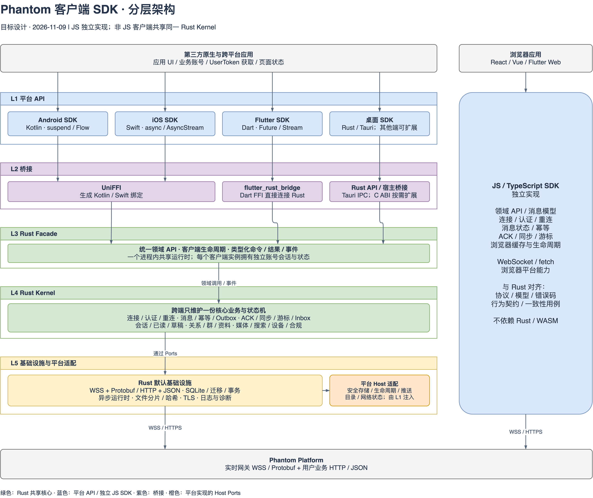
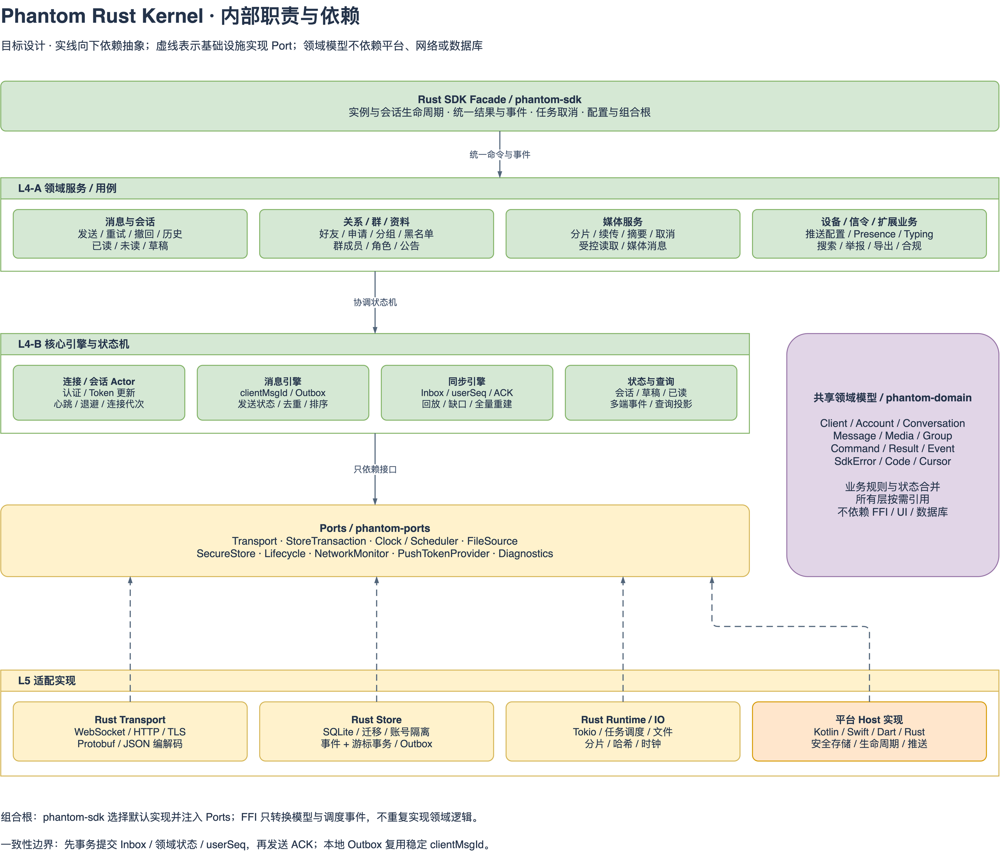

# Phantom 客户端 SDK 分层架构设计

> 日期：2026-11-09。状态：目标架构设计，尚未实现。适用范围：`phantom-platform` 提供给第三方应用的客户端 SDK，以及 Easy IM 对这些 SDK 的使用方式。

JS 与原生 SDK 的统一架构入口见[客户端 SDK 架构文档](../sdk/architecture.md)。本文保留为原生分层方案的扩展草案。

## 1. 设计结论

采用“**统一契约、两条实现路径、原生客户端共享 Rust Kernel**”的架构：

- **JS / TypeScript SDK 独立实现**，继续服务浏览器；与 Rust SDK 对齐协议、领域模型、错误码和业务行为。
- **Android、iOS、Flutter 原生端及后续原生桌面 SDK 共享 Rust 核心**。连接、认证、消息状态、ACK、同步、游标、媒体上传和本地存储在 Rust 中实现一次。
- **Android 使用 Kotlin 包装，iOS 使用 Swift 包装，Flutter 使用 Dart 包装**。包装层提供本平台的异步 API、事件流及系统能力适配。
- **平台系统能力通过 Ports 注入 Rust**。系统通知、推送 Token、安全存储、生命周期、网络状态和沙箱路径由平台实现；Rust 管理这些输入触发的业务行为。
- **UI 与应用账号属于宿主应用**。SDK 提供无 UI 的领域能力，应用服务端签发 UserToken。

Rust Kernel 指共享的客户端领域逻辑与核心引擎，不是重新划分服务端职责。当前 Phantom Platform 的 WSS / Protobuf、HTTP / JSON 服务契约继续作为所有客户端的共同服务边界。

## 2. SDK 总体分层图



[可编辑 draw.io 源文件](diagrams/client-sdk-layered-architecture.drawio)。图中绿色表示 Rust 共享层，蓝色表示平台 API 或独立 JS SDK，紫色表示桥接，橙色表示平台侧 Host 适配。实线表示调用关系，Host 虚线表示通过注入的接口调用平台实现。

| 层次 | 职责 | 技术与主要产物 | 不应放入的逻辑 |
| --- | --- | --- | --- |
| 宿主应用 | UI、页面状态、应用账号、获取 UserToken、按实际阅读上报已读 | Android / iOS / Flutter / 桌面 / Web 应用 | AppSecret 签发逻辑不能进入客户端 |
| **L1 平台 API 层** | 平台习惯的公共 API、事件派发、取消映射、系统适配与资源生命周期 | Kotlin SDK、Swift SDK、Dart SDK、桌面宿主 API | 消息排序、幂等、ACK、重连算法、同步状态机 |
| **L2 桥接层** | 方法调用、DTO、句柄、事件、错误和内存所有权转换 | UniFFI、flutter_rust_bridge；Rust 直接调用 / Tauri IPC，C ABI 按需扩展 | 业务校验和领域状态，不实现第二份核心 |
| **L3 Rust Facade 层** | 统一类型化领域 API、客户端实例生命周期、配置、任务取消、事件入口、依赖组装 | `phantom-sdk` | Kotlin / Swift / Dart 类型和 UI 依赖 |
| **L4 Rust Kernel 层** | 领域服务、核心状态机、消息与同步一致性、业务规则 | `phantom-core`、`phantom-domain` | Android / Apple API、具体 SQL、HTTP 库和 FFI 细节 |
| **L5 基础设施与平台适配层** | 实现 Transport、Store 等 Port；接入系统能力 | Rust 默认网络 / SQLite / 文件与运行时；平台 Host 实现 | 再次实现 L4 业务规则 |
| Phantom Platform | 消息收单、投递、同步 Timeline 与领域 HTTP 服务 | 共享 Protobuf、HTTP JSON、平台鉴权 | 不依赖客户端的桥接技术 |

图中 L5 同时展示 Rust 默认实现与平台注入的 Host 实现，**不表示 Kotlin / Swift / Dart 代码编译进 Rust**。Ports 定义在内层，实现在外层，Facade 组合根完成注入。

## 3. 各平台接入路线

| 平台 / 使用方式 | 应用看到的 API | 进入 Rust 的路径 | 包装和分发目标 |
| --- | --- | --- | --- |
| Android 原生 | Kotlin `suspend`、`Flow`、类型化结果 | Kotlin → UniFFI → Rust Facade | AAR，包含目标 ABI 的原生库和 Kotlin 代码 |
| iOS 原生 | Swift `async/await`、`AsyncStream`、类型化错误 | Swift → UniFFI → Rust Facade | Swift Package + XCFramework，覆盖真机与模拟器目标 |
| Flutter Android / iOS / 桌面 | Dart `Future`、`Stream`、类型化模型 | Dart → flutter_rust_bridge → Rust Facade | Dart 包 / Flutter 插件 + 各目标原生库 |
| Rust 桌面宿主 | Rust 异步 API | 直接依赖 `phantom-sdk` | Rust crate，业务内核与宿主进程一起构建 |
| Tauri 桌面宿主 | 前端统一适配器，后端持有 Rust Client | Tauri command / channel → Rust Facade | 按桌面平台构建；前端使用 SDK 桥接 API |
| 其他原生宿主，按需扩展 | 宿主语言 API | 语言包装 → C ABI → Rust Facade | 有明确调用方后再提供稳定 C 头文件及动态库 |
| Web / JS | TypeScript Promise、事件订阅 | 现有 JS SDK → 平台服务 | `@phantom/sdk-web` |
| Flutter Web，若后续支持 | Dart API | Dart 的 Web 适配 → JS SDK | 与原生 Flutter 共用接口定义，Web 实现单独适配 |

这些是选定的目标路线，分发产物尚未创建。UniFFI 官方文档提供 Kotlin / Swift 绑定路线；flutter_rust_bridge 官方文档提供 Dart / Rust 桥接路线。使用前锁定版本并验证异步、回调和资源释放语义，不把生成代码中的细节作为长期公共 API。

Flutter 是面向应用的另一种上层选择：可以只用 Flutter UI + Dart SDK，无需再调用 Kotlin SDK 或 Swift SDK。少量必须进入操作系统的功能使用 Flutter 平台插件完成；插件不重复实现消息、重连或同步。

Flutter Web 即使存在 Rust / WASM 技术路线，本设计仍走独立 JS SDK，以满足“JS SDK 不依赖 Rust Kernel”的边界。该 Dart Web 适配目前只是预留设计。

## 4. Rust Kernel 内部结构



[可编辑 draw.io 源文件](diagrams/client-sdk-rust-kernel.drawio)。实线向下依赖抽象，底部虚线向上表示基础设施实现 Port；右侧领域模型由各层按需引用，不依赖网络、数据库、FFI 或平台。

### 4.1 领域服务

领域服务把现有 JS SDK 公开能力组织成用例；可按模块暴露，通过统一 Client 访问：

| 服务 | 主要能力 |
| --- | --- |
| `Client / Session` | 登录、退出、Token 更新、连接状态、被踢下线、配置与数据就绪状态 |
| `MessageService` | 发送、重试、撤回、转发、历史、引用、@、当前用户删除 |
| `ConversationService` | 会话列表与详情、置顶、免打扰、已读、未读、草稿、消息请求 |
| `RelationService / ProfileService` | 好友、申请、分组、黑名单、二维码名片和用户资料 |
| `GroupService` | 群资料、成员、角色、公告、禁言、转让、退出及邀请能力 |
| `MediaService` | 分片上传、续传、取消、校验、媒体元数据、受控读取和发送 |
| `DeviceService / SignalService` | 设备、远程下线、推送设置、Presence、Typing、前后台状态 |
| `SearchService / ComplianceService` | 搜索、举报、申诉、导出、未成年人模式和隐私链接 |

模块能力参考[当前 JS API 清单](../sdk/integration.html#js-api)。尚未被 JS 封装的平台功能需在能力矩阵中明确标为新增，不能假定已经全端支持。

### 4.2 核心引擎与状态归属

| 核心引擎 | 唯一管理的状态和规则 |
| --- | --- |
| 连接 / 会话 Actor | 连接代次、认证、心跳、重连退避、会话失效、Token 更新与退出；串行化影响当前会话的状态转换 |
| 消息引擎 | clientMsgId、Outbox、发送状态、服务器 ID 合并、convSeq 排序、幂等、撤回和终态合并 |
| 同步引擎 | Inbox、userSeq、ACK、离线回放、在线事件去重、缺口恢复、全量重建与快照期间的并发事件 |
| 状态与查询引擎 | 会话、已读、草稿、关系、群、资料的本地投影；版本冲突处理、增量事件与查询一致性 |
| 媒体任务引擎 | 文件源、摘要、分片会话、已传分片、上传进度、取消与完成校验；作为 MediaService 的内部任务 |

包装层可以缓存用于渲染的 UI 状态，但领域状态的权威本地版本由 Rust 管理。Kotlin、Swift 和 Dart 不能分别推进 userSeq、生成第二套自动重连、决定已确认消息的最终排序或重复维护发送队列。

### 4.3 共享模型

Rust 定义统一 `ClientConfig`、`LoginOptions`、`Message`、`Conversation`、`Media`、领域 Command / Result / Event 及 `SdkError`。

- 消息 ID、设备 ID、账号 ID 和会话 ID 使用不透明字符串；convSeq 与 userSeq 明确区分。
- 时间明确标注单位；原生公共模型使用足够范围的整数表示序号，FFI 不经 double 中转。
- Protobuf 生成类型是内部 wire model，不直接成为稳定公共 API；HTTP snake_case 在网络适配层完成映射。
- FFI 模型仅承载可安全转换的数据；文件句柄、任务句柄和订阅句柄采用显式所有权模型。
- JS 保留当前公共 API 的兼容性，通过适配与共同测试对齐行为，不要求它直接加载 Rust 类型。

## 5. Ports 与依赖方向

建议定义以下 Port，默认实现集中维护，系统实现由宿主注入：

| Port | 默认实现或注入来源 | 设计边界 |
| --- | --- | --- |
| `Transport` | Rust 的 WebSocket / HTTP / TLS 适配 | Rust 统一请求配对、序列化和网络结果；平台层不再次请求同一条业务链路 |
| `Store / StoreTransaction` | Rust SQLite | 存储格式、迁移、索引、Outbox、Inbox、游标与领域投影共同演进 |
| `Clock / Scheduler` | Rust 运行时与可替换时钟 | 超时、退避、输入状态等核心定时逻辑可测试 |
| `FileSource` | Rust 文件 / 平台提供的受控读取能力 | Android URI、Apple 沙箱文件等先适配为统一文件源；大文件按块读取 |
| `SecureStore` | Android Keystore 支持的实现、Apple Keychain 或宿主提供的实现 | 管理设备密钥等安全材料；UserToken 的更新权限由应用服务端决定 |
| `Lifecycle / NetworkMonitor` | Android / Apple / Flutter / 桌面宿主 | 提供前后台、可用网络与系统限制信号；连接决策由 Kernel 执行 |
| `PushTokenProvider / NotificationRouter` | 系统推送与通知适配 | 取得平台 Token、转发点击；Kernel 管理注册与相关领域状态 |
| `Diagnostics` | Rust 日志与平台日志出口 | 诊断事件、请求标识与脱敏；不输出凭据和敏感正文 |

编译依赖方向：

1. `phantom-domain` 为底层模型与业务规则，不依赖平台或具体基础设施。
2. `phantom-ports` 依赖领域类型，定义能力接口。
3. `phantom-core` 依赖 domain / ports，实现服务与引擎。
4. transport、store、runtime 等模块实现 Ports，不能让 core 反向依赖具体网络库或数据库库。
5. `phantom-sdk` 是对外 Facade 与组合根，组装 core、默认基础设施及 Host 注入对象。
6. UniFFI / Dart / C ABI 桥接依赖 Facade，平台包装层依赖对应桥接。

运行时可以从内核调用 Host Port；这通过接口发生，不改变编译依赖方向。平台回调不能在持有内核状态锁时重入 Kernel，异步输入回到会话事件队列处理。

### 复用与工作量边界

| 内容 | 维护方式 |
| --- | --- |
| 消息、同步、重连、媒体任务、领域规则、SQLite 结构与迁移 | 所有原生端维护同一份 Rust 实现及核心测试 |
| Kotlin / Swift 绑定样板 | 由同一 Rust 桥接定义生成，包装层提供惯用 API |
| Dart 绑定样板 | 从同一 Facade 的 Dart 桥接生成，不重新编写核心逻辑 |
| 系统权限、通知、文件选择、安全存储与生命周期 | 各平台实现较薄的 Host 适配并分别集成测试 |
| Web 核心 | 保留独立 JS 实现，以共享协议和一致性测试控制分歧 |
| 原生构建与发行 | 按目标架构分别构建、签名、打包和验收 |

复用收益来自业务状态机与持久化规则集中维护，新增成本主要是桥接边界和各目标的构建分发。不能用一套 Rust 代码替代全部系统适配与真机验收。

## 6. FFI、异步和资源生命周期

### 6.1 运行时与实例

进程内由 Rust 管理共享异步运行时；每个 Client 维护独立的 appId、账号会话、状态和订阅。不能为每次 FFI 调用或每个语言包装对象创建新的运行时。

- 登录、退出和 Token 更新通过同一会话控制入口串行处理。
- 连接与账号带 generation / epoch；旧连接响应、旧任务结果和旧账号事件不能污染当前会话。
- 对外方法不阻塞 UI 主线程。网络、数据库和文件任务在 Rust 调度；平台 UI 事件由包装层派发到正确执行上下文。
- 同一 App 的消息链路选择一种主桥接入口；Flutter 插件直接携带 Rust Kernel，不再叠加包含另一份 Kernel 的原生 IM SDK。确需混合调用时，共享同一原生库与 Client 句柄，避免重复链接、重复运行时与双连接。
- 桥接仅选取同一 Kernel 逻辑，不产生“UniFFI 版本 Kernel”与“Flutter 版本 Kernel”。原生库产物按目标分别构建，不能把“一份实现”理解成“一个二进制适用全部平台”。

### 6.2 调用与事件模型

目标接口示意，**不是当前已存在的 SDK 方法声明**：

| 语义 | Rust Facade | Android | iOS | Flutter |
| --- | --- | --- | --- | --- |
| 登录 | 异步 login → Result | suspend | async throws | Future |
| 业务调用 | 类型化输入 → Result / 任务句柄 | suspend / 可取消任务 | async throws / Task 适配 | Future / 显式任务取消 |
| 订阅事件 | 持有可关闭的 Subscription | Flow + close | AsyncStream + 关闭/终止 | Stream + cancel |
| 切换 Token | 明确的会话控制命令 | 包装同一控制入口 | 包装同一控制入口 | 包装同一控制入口 |
| 退出 | 清理账号状态并终止会话任务 | logout | logout | logout |
| 释放实例 | close / dispose；结束回调 | 显式 close | 显式 close + 生命周期兜底 | 显式 dispose |

桥接生成器对 Future、Task 和订阅终止的映射必须单独验证；不能认为宿主取消等待就一定取消了 Rust 内部任务。Dart Future 没有被本设计当作自动取消机制，上传等长任务提供显式取消入口。

事件采用带类型的封装，至少区分 connection、dataReady、message、conversation、relation、group、profile、mediaProgress、presence、typing、kicked、tokenExpired、syncRequired 和 error。事件包含账号会话标识和实例内顺序号，按需带 userSeq；实例事件顺序号不能冒充服务器游标。

可靠领域事件不得因 UI 消费慢而静默丢弃。先提交本地状态，再分发事件；订阅队列溢出时发出可观察的重建通知，应用可从 Rust 查询快照恢复。Presence、Typing、进度等可合并的瞬态事件单独规定合并策略。

### 6.3 内存、句柄和错误

- 由创建方管理 Client / Task / Subscription 句柄，通过明确 API 释放；dispose 后停止回调并取消实例任务。
- Flutter isolate 及系统 UI 线程上的回调由包装层调度，Rust 工作线程不能直接访问平台 UI 对象。
- 大文件采用路径、受控文件源或分片流，不把整个视频反复复制为 Kotlin byte[]、Swift Data、Dart Uint8List 和 Rust Vec。
- 统一错误保留 `kind`、平台业务 `code?`、`message`、`requestId?`、任务/消息标识及必要的重试建议；取消和超时有明确终态。
- Rust panic 不穿越 FFI 边界；预期业务失败不使用 panic。桥接必须有稳定的错误转换规则。

## 7. 消息、同步与本地一致性

核心目标是把所有原生端最容易产生差异的规则收敛到 Rust：

1. 生成稳定 clientMsgId，将消息以 sending 写入本地 Outbox 与消息投影，再提交发送。用户明确重试复用原 ID。
2. 网络响应与自己消息回推可能交叉到达，以 msgId / clientMsgId 合并同一实体，convSeq 排序，已读、撤回等终态不被旧响应覆盖。
3. 在线推送和离线回放进入同一 Inbox / 同步入口，按 userSeq 去重并处理缺口，不能见到高序号就跳过未应用事件。
4. **领域状态、Inbox 去重记录和 userSeq 在同一事务提交后再发 ACK**；崩溃恢复以已提交状态为准。
5. fullResync 使用会话快照与历史重建，并协调重建期间的在线事件，避免快照最大游标覆盖未消费事件。
6. 草稿、已读、关系、群和资料事件更新本地投影后再通知宿主；UI 从 Kernel 查询可恢复快照。
7. 本地数据库按 appId + userId 隔离，迁移显式版本化。退出和换账号按策略清理；已删除、撤回、焚毁内容不能因回放或缓存恢复而复活。

Outbox 在本设计中用于幂等与崩溃恢复；**是否允许离线提交新消息、何时自动重试、退出时保留哪些待发任务，需要在实现前形成独立产品规格**。架构预留能力，不据此承诺现有 SDK 已支持离线发件。

当前 JS 参考实现中的已知缺口见[差异表](../sdk/cross-language-contract.md#当前-js-参考实现的差异与限制)。Rust 应按目标契约实现，不复制其配置字段错误、非原子游标写入、事件去重或状态倒退问题；JS 后续通过同一组一致性用例逐步对齐。

## 8. 包装层保留的系统职责

| 场景 | 包装层 / 宿主 | Rust Kernel |
| --- | --- | --- |
| App 进入前后台 | 监听平台生命周期，发送输入信号 | 上报状态、调整连接及恢复策略 |
| 系统限制后台执行 | 遵守系统调度与通知机制 | 恢复运行时补齐同步；不能承诺进程被挂起后持续在线 |
| 推送通知 | APNs、Android 对应推送适配、权限与点击 | 注册/注销 Token，通知目标与会话领域状态 |
| 文件选择与访问 | 相册、录音、文档选择、URI / 沙箱权限 | 摘要、分片、续传、取消、媒体消息与访问校验结果 |
| 安全材料 | 提供系统安全存储能力 | 按接口使用，不把平台密钥写入普通消息缓存 |
| 用户刷新 Token | 应用服务端校验自有会话，宿主取得新 Token | 接收新 Token，串行更新认证状态 |
| UI 已读与焚毁触发 | 反馈消息实际展示/阅读事件 | 已读推进、计时与敏感内容失效规则 |

Flutter 使用平台插件处理这些系统职责，但不需要为插件再嵌套完整 Android / iOS IM SDK。

## 9. 建议的代码与产物布局

以下目录均为**建议新增结构**；本次只提交设计和图，不创建可运行 Rust SDK：

```text
phantom-platform/sdks/
├── web/                         # 已有，独立 JS / TypeScript SDK
├── rust/                        # 建议：Cargo workspace
│   ├── crates/
│   │   ├── phantom-domain/      # 领域类型、错误、规则
│   │   ├── phantom-ports/       # 基础设施与 Host 接口
│   │   ├── phantom-core/        # 用例、状态机、同步与查询
│   │   ├── phantom-protocol/    # Protobuf / HTTP wire 映射
│   │   ├── phantom-transport/   # 网络默认实现
│   │   ├── phantom-store/       # SQLite 默认实现
│   │   ├── phantom-runtime/     # 调度与 IO 适配
│   │   ├── phantom-sdk/         # Facade / 组合根
│   │   ├── phantom-ffi-uniffi/  # Kotlin / Swift 生成边界
│   │   └── phantom-ffi-dart/    # Dart 生成边界
│   └── tests/                  # 契约、状态机与一致性场景
├── android/                     # Kotlin 包装、Host 适配、AAR 工程
├── ios/                         # Swift 包装、Host 适配、SPM 工程
├── flutter/                     # Dart 包装、插件、原生库打包
└── conformance/                 # JS / Rust 共用场景、输入和预期
```

Rust 的网络默认实现建议组合 Tokio、HTTP / WebSocket 库、TLS 库及 Protobuf 编码库，持久化默认 SQLite。具体依赖版本、数据库加密方案和底层文件接口在 PoC 后锁定，不在架构图中承诺未经验证的跨端适配结果。

绑定层与语言包装包独立发布，但要记录 Rust Kernel 版本、绑定生成器版本、公共模型版本和服务协议能力。平台 SDK 的发行版本映射到明确的 Kernel 构建，避免不同平台携带不同业务规则。

## 10. 与现有 Easy IM 客户端的衔接

当前现状：

- `phantom-platform/sdks/web/` 是现有 TypeScript SDK。
- Easy IM Web 通过 [PhantomSdkAdapter](../../../phantom-im/clients/web/src/phantom/sdk-adapter.ts)封装该 SDK。
- 当前 [PC Tauri 宿主](../../../phantom-im/clients/pc/src-tauri/src/lib.rs)装载复用的 Web 页面，消息链路仍沿用 Web SDK；已有 Rust 宿主不等于已经有 Rust IM Kernel。

迁移目标：

1. 先稳定语言无关的 Command / Model / Event / Error 和一致性测试，保留现有 Web 接入入口。
2. 新 Android / iOS / Flutter 原生 SDK 直接接入 Rust，避免先做一套平台独立内核再迁移。
3. 如将 Easy IM PC 消息链路切换到 Rust，复用前端边界适配器，用 Tauri command / channel 调用同一个 Rust Client。
4. PC 切换以会话为单位：同一账号和设备只保留一条活动消息引擎；Web SDK 与 Rust SDK 不同时竞争连接、同步游标和推送状态。
5. Web 继续使用 JS SDK。共同行为测试约束两个实现，平台 UI 差异留在包装层。

## 11. 建议实施顺序与验收

| 阶段 | 交付范围 | 关键验收 |
| --- | --- | --- |
| P0 桥接 PoC | 同一 Rust Client 暴露异步调用、事件、取消、close；分别生成 Kotlin / Swift / Dart 接口 | 真机与模拟器可加载；回调线程正确；取消和释放无泄漏；依赖和产物可复现 |
| P1 核心链路 | 认证、连接、心跳、文本、ACK、Outbox / Inbox、SQLite、增量同步、全量重建 | 断网、超时、重复、乱序、进程退出、换账号和被踢下线等场景一致 |
| P2 完整领域 | 媒体、会话、关系、群、资料、设备、搜索、合规及系统 Host 适配 | 对齐 API 能力矩阵，上传续传/取消、会话回滚和各领域同步正确 |
| P3 多端分发与迁移 | Android / Swift / Flutter 包、文档、版本映射；按需迁移 PC | 原生库目标完整、包集成测试、跨端业务一致性及真实平台 E2E |

P0 是验证跨语言边界，不能只验证一个字符串函数。至少验证长连接事件、并发请求、媒体任务取消、数据库路径、安全存储回调和客户端释放。

共用一致性场景应以可版本化输入 / 预期维护，由 JS 和 Rust 分别执行，不要求两者共享二进制。除[既有跨语言验收清单](../sdk/cross-language-contract.md#8-跨语言验收清单)外，还需覆盖 FFI 句柄、回调重入、主线程调度、事件背压、动态库重复加载和后台恢复。

## 12. 设计依据与产物维护

仓库依据：[JS API 文档](../sdk/README.md)、[Web SDK 规格](../../../openspec/specs/web-sdk/spec.md)、[Protobuf 契约](../../../phantom-platform/contracts/proto/phantom/v1/)及现有 Web / Tauri 消费方代码。

桥接选型参考官方文档（2026-11-09 读取）：

- [UniFFI：Kotlin / Swift 绑定与异步支持](https://mozilla.github.io/uniffi-rs/latest/)
- [flutter_rust_bridge：Dart / Rust 绑定](https://cjycode.com/flutter_rust_bridge/)
- [Tauri：从前端调用 Rust](https://v2.tauri.app/develop/calling-rust/)

图由 [生成脚本](../../../tools/architecture/generate-client-sdk-diagrams.py)生成，使用 `drawio-skill` 工作流制作并校验。技能位于本机用户目录，不属于仓库依赖；异机只需脚本与 draw.io 即可维护源图。更新方式：

```bash
python3 tools/architecture/generate-client-sdk-diagrams.py
# 使用 draw.io 打开对应 .drawio 编辑，或用其 CLI 导出预览。
# PNG 若采用嵌入 XML 导出，应按使用的 draw.io 版本验证文件完整性。
```
