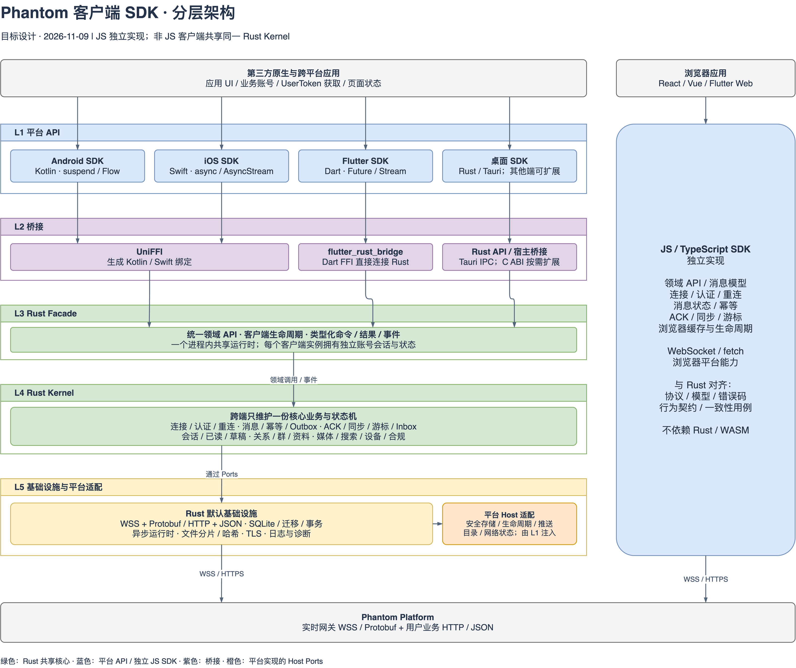
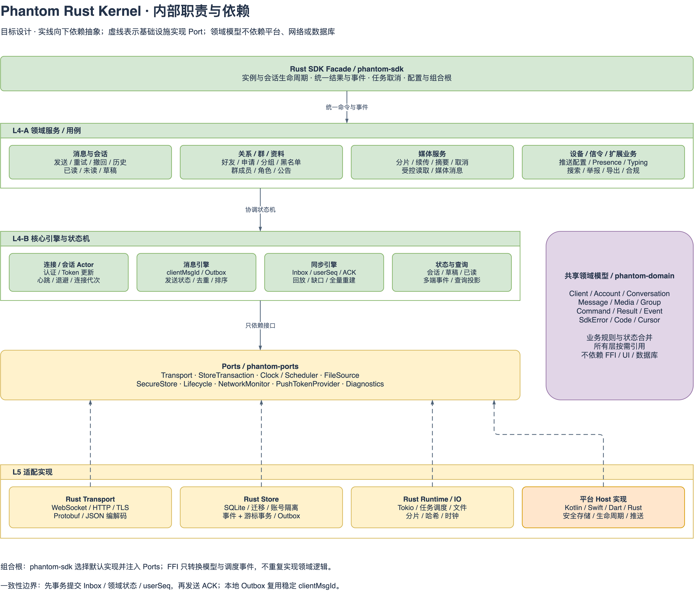

# Phantom 客户端 SDK 架构文档

> 更新日期：2026-11-10。版本：评审稿 v0.1。本文描述 JS SDK 的当前架构，以及后续原生 SDK 的目标架构；Rust Kernel 和各原生包装层尚未实现。
>
> “JS SDK”和“原生SDK”为本次要求的两个主体章节。其余章节作为建议结构提供，技术选型和待确定的行为集中列在“待确认事项”，供审阅后确定。

## 目录

- [文档范围与设计原则](#文档范围与设计原则)（建议章节）
- [总体架构](#总体架构)（建议章节）
- [JS SDK](#js-sdk)
- [原生SDK](#原生sdk)
- [共享契约与跨端一致性](#共享契约与跨端一致性)（建议章节）
- [工程组织与版本发布](#工程组织与版本发布)（建议章节）
- [实施顺序与验收](#实施顺序与验收)（建议章节）
- [待确认事项](#待确认事项)（建议章节）

## 文档范围与设计原则

### 文档用途

本文面向客户端 SDK 的架构设计、开发、评审和维护。第三方应用具体如何登录、调用方法及处理返回值，分别查阅[接入指南](getting-started.md)、[API 参考](integration.html#js-api)和[数据模型](data-models.md)。

本文中的“当前实现”来自仓库源码；“目标架构”表示后续开发应遵循的职责划分；“建议”表示有待确定的实现方案，不代表已经形成兼容性承诺。

### 已明确的架构方向

| 方向 | 说明 |
| --- | --- |
| JS SDK 独立实现 | JS / TypeScript SDK 保持独立，浏览器运行不依赖 Rust Kernel |
| 非 JS 原生 SDK 共享核心 | Android、iOS、Flutter 原生端及后续原生桌面 SDK 的 Kernel 使用 Rust 实现 |
| 平台技术包装 | Android 提供 Kotlin API，iOS 提供 Swift API，Flutter 提供 Dart API；其他平台按宿主技术包装 |
| 分层开发 | 平台 API、桥接、Rust Facade、Rust Kernel、基础设施与平台适配分别承担明确职责 |
| 统一服务契约 | 所有 SDK 对接同一套 Phantom Platform 通信契约与领域能力 |

这里的“原生SDK”包含使用原生库的 Flutter 移动端和桌面端。Flutter Web 属于浏览器运行场景；如后续提供支持，应单独适配 JS SDK。

### 职责原则

1. 消息、重连、同步、幂等和本地状态规则在原生端集中到 Rust，平台包装层只做 API 和系统能力适配。
2. 平台依赖通过接口注入，核心业务不直接依赖 Android、Apple、Flutter 或桌面 UI 类型。
3. SDK 提供无 UI 的领域能力；应用账号登录、UserToken 签发和页面展示由接入方负责。
4. 当前实现与目标能力分开描述；JS 中的已知实现缺口不作为新 SDK 的设计依据。
5. 同一份 Rust 源码按目标平台构建不同原生产物，并分别集成验证。

## 总体架构

客户端 SDK 采用“统一契约、两条实现路径”的组织方式。

| 维度 | JS SDK | 原生SDK |
| --- | --- | --- |
| 运行场景 | 浏览器及经过应用验证的 WebView 场景 | Android、iOS、Flutter 原生端、原生桌面宿主 |
| 公共 API | TypeScript / JavaScript | Kotlin、Swift、Dart 或宿主语言 |
| 核心逻辑 | TypeScript 独立实现 | 共享 Rust Kernel |
| 网络适配 | 浏览器 WebSocket / fetch | Rust 网络适配与平台必要输入 |
| 本地状态 | 当前为内存缓存与 localStorage | 建议使用 Rust 管理的本地数据库与事务 |
| 系统能力 | 浏览器提供的生命周期、通知权限等 | 通过平台 Host 接口提供生命周期、推送、安全存储等 |
| 共同约束 | 相同服务契约、领域语义、错误码含义和一致性场景 | 相同服务契约、领域语义、错误码含义和一致性场景 |

实时认证、收发、信令和同步使用 WebSocket / Protobuf；领域查询与写入、历史、搜索和媒体使用 HTTP / JSON。具体方法采用哪个通道，以[接口映射](integration.html#js-api)及服务端契约为准，不能因协议中存在同名指令就自行切换调用方式。

SDK 接收应用服务端签发的 UserToken。AppSecret 不进入任何客户端 SDK。应用服务端负责业务账号与 Phantom ID 的映射；平台负责租户隔离、鉴权、消息序号和服务端幂等。

## JS SDK

### 定位与当前实现

当前 JS SDK 为 `phantom-platform/sdks/web/` 下的 `@phantom/sdk-web`，使用 TypeScript 开发。当前包版本为 `0.1.0`，入口直接导出 TypeScript 源码。

主要文件：

| 文件 | 当前职责 |
| --- | --- |
| [src/index.ts](../../../phantom-platform/sdks/web/src/index.ts) | `PhantomClient`、公开类型、事件订阅、领域方法、连接与同步、消息缓存和 HTTP 封装 |
| [src/proto.ts](../../../phantom-platform/sdks/web/src/proto.ts) | Protobuf 类型加载、命令枚举与单聊会话 ID 辅助函数 |
| [src/proto-bundle.json](../../../phantom-platform/sdks/web/src/proto-bundle.json) | 供运行时加载的协议描述符 |
| [test/sdk.test.ts](../../../phantom-platform/sdks/web/test/sdk.test.ts) | 现有单元测试与行为回归场景 |

当前实现主要集中在 `PhantomClient` 中。下面的分层是其**逻辑职责划分**，不表示已经拆成多个独立模块。

### 逻辑分层

| 逻辑层 | 当前承担的职责 | 与宿主应用的边界 |
| --- | --- | --- |
| 公共 API 与事件 | `login`、`sendMessage`、领域方法及 `on/off` 订阅 | 宿主通过方法和事件接入，不直接操作底层帧 |
| 领域行为 | 消息乐观态、发送结果合并、历史合并、撤回状态、会话操作等 | UI 按消息身份更新展示，不自行复制 SDK 的发送状态 |
| 连接与同步 | WebSocket 认证、心跳、请求配对、重连、推送、ACK、增量和全量同步 | 宿主负责提供 Token，按需处理过期、被踢下线与页面状态 |
| 通信适配 | Protobuf 编解码、Envelope、HTTP 认证头、JSON 请求及响应处理 | 宿主配置服务地址；不持有 AppSecret |
| 浏览器存储与平台能力 | 内存消息缓存、localStorage、pagehide 刷盘、通知权限、Blob 上传 | 受浏览器能力限制；不等于完整的系统通知或后台执行实现 |

### 主要交互链路

**登录与初始化：**宿主取得 UserToken 和设备标识，调用 `login()`；SDK 恢复本地缓存、建立 WebSocket、发送认证请求，成功后启动心跳并按游标同步。`connected` 表示认证成功，早于初始同步结束，不能直接等同于历史数据全部加载完成。

**发送消息：**SDK 生成或复用 clientMsgId，先发布 sending 乐观态，再发送协议请求；成功后回填服务端 ID、convSeq 和时间。当前发送业务失败及部分传输异常会返回 `state='failed'` 的消息，宿主需检查状态，不能只依赖 Promise 拒绝。

**接收与同步：**SDK 处理推送、发送 ACK，并将同步变化应用到本地消息或转为领域事件。由于当前实现尚未完整维护所有领域投影，宿主收到会话、关系、群等事件后可能需要重新查询对应数据。

**历史与缓存：**`history()` 返回 HTTP 原始消息项，同时合入本地消息缓存；宿主通过 `getMessages()` 读取用于展示的领域消息。JS 消息对象和 Protobuf 事件使用 camelCase，大部分 HTTP 返回仍保留 snake_case。

**媒体：**宿主提供文件及摘要等参数，SDK 执行初始化、剩余分片上传和完成请求。当前 AbortSignal 只传入分片上传；浏览器通知权限也不代表 SDK 已实现系统通知的完整投递链路。

### 当前架构边界与演进建议

JS SDK 当前使用浏览器全局 WebSocket、fetch、Blob 和 localStorage 等能力。Node.js、React Native、小程序等环境的直接支持需单独验证，不能根据 TypeScript 语言本身推断兼容性。

当前主要限制及行为差异统一维护在[跨语言契约的实现差异表](cross-language-contract.md#当前-js-参考实现的差异与限制)。例如配置读取、同步去重、状态合并、缓存一致性和会话状态维护等问题，不能当作原生 SDK 应照搬的行为。

建议后续按公共 API、领域服务、连接与同步、网络适配、存储适配逐步拆分内部职责，保持既有对外接口的兼容性。是否新增强类型 HTTP 模型、统一错误结构和完整释放入口，需要先确定接口与迁移策略。

已按[SDK 修改完善记录](sdk修改完善记录.md)将构造参数 `url/httpBaseUrl` 合并为 `baseUrl`。该参数使用 HTTP/HTTPS 绝对地址，支持路径前缀并移除末尾 `/`；HTTP 直接追加接口路径，WebSocket 转换为 WS/WSS 后追加 `/ws`。旧地址参数已移除。Easy IM 在应用适配层通过注入 `fetch` 保留 HTTP 经 BFF 代理、WebSocket 直连平台的接入方式。

## 原生SDK

### 设计定位

原生 SDK 采用“**平台包装层 + 桥接层 + 共享 Rust 核心**”结构。应用仍使用本平台熟悉的 API，Rust 负责跨端一致的业务规则与持久化状态。

核心复用范围包括连接认证、重连、消息状态、发送幂等、ACK、同步游标、会话与领域投影、媒体任务等。系统生命周期、通知、推送、安全存储和文件授权保留在平台适配层。

以下是目标设计，尚未存在可供第三方集成的 Rust、Android、Swift 或 Flutter SDK 产物。

### 总体分层架构图



图源：[可编辑 draw.io 文件](../architecture/diagrams/client-sdk-layered-architecture.drawio)。图中右侧 JS SDK 用于标明浏览器实现与 Rust 实现的边界；两者对接同一平台服务。

图示说明：

1. 顶部是第三方宿主应用，负责 UI、自有账号和获取 UserToken。
2. 从 L1 到 L5，依次是平台 API、桥接、Rust Facade、Rust Kernel、基础设施与平台适配。
3. Android、iOS、Flutter 和桌面入口最终进入同一套 Rust 领域 API，不分别实现核心消息与同步逻辑。
4. 蓝色表示平台 API 或独立 JS SDK，紫色表示桥接，绿色表示共享 Rust 层；黄色表示默认基础设施，橙色表示平台侧实现。
5. Host 适配由平台层提供，再注入 Rust 使用。图中它位于 L5 的适配职责区，不表示 Kotlin、Swift 或 Dart 代码被编译进 Rust。
6. 底部是 Phantom Platform，Rust 网络适配与 JS SDK 分别通过 WSS / HTTPS 接入。

### 分层职责与开发边界

| 层次 | 职责 | 开发边界 |
| --- | --- | --- |
| **L1 平台 API** | Kotlin / Swift / Dart 等公共 API、平台异步类型、事件流、主线程派发、Host 实现与资源生命周期 | 不生成第二套消息排序、ACK、重连或同步游标逻辑 |
| **L2 桥接** | 方法、DTO、错误、句柄、回调及内存所有权转换 | 不包含领域校验和业务状态机；生成代码不直接作为长期稳定的公共 API |
| **L3 Rust Facade** | 统一 Client API、配置、实例生命周期、任务取消、事件出口和依赖组装 | 不暴露平台 UI 类型；不要求调用方理解 Protobuf 或数据库格式 |
| **L4 Rust Kernel** | 领域服务、连接与消息引擎、同步、状态合并、本地投影及业务规则 | 依赖领域类型和能力接口，不直接依赖具体 FFI、平台 API、网络库或 SQL 实现 |
| **L5 基础设施与平台适配** | 网络、协议映射、数据库、运行时、文件处理及系统 Host 接口实现 | 实现内层接口；基础设施不能反向成为核心业务的编译依赖 |

### Rust Kernel 内部架构图



图源：[可编辑 draw.io 文件](../architecture/diagrams/client-sdk-rust-kernel.drawio)。

图示说明：

- **Rust Facade** 是所有桥接共享的入口，统一管理实例、结果、事件和任务生命周期，同时作为默认实现的组合根。
- **领域服务 / 用例层** 组织消息、会话、关系、群、媒体、设备、搜索及合规等能力，调用下面的核心引擎完成具体行为。
- **核心引擎与状态机** 集中处理跨端最容易发生差异的连接、消息、同步和查询状态。
- **共享领域模型** 由各层按需使用；消息、会话、事件、游标与错误等类型不依赖 FFI、UI、网络或数据库。
- **Ports** 定义核心需要的能力；网络、SQLite、运行时和系统适配实现这些接口。实线向下表示依赖抽象，底部向上的虚线表示实现接口。
- 核心业务通过 Ports 调用能力，Facade 将实现注入；这样可以替换基础设施并在测试中注入网络、时钟和存储故障。

### 核心模块与状态归属

| 模块 | 负责的核心状态与规则 | 平台包装层的配合 |
| --- | --- | --- |
| 连接与会话引擎 | 认证、连接代次、心跳、退避、Token 更新、被踢下线及退出 | 提供 Token、生命周期和网络状态输入 |
| 消息引擎 | clientMsgId、Outbox、发送状态、服务端回推合并、排序、撤回和终态 | 展示状态，提交用户发送、重试和撤回操作 |
| 同步引擎 | Inbox、userSeq、ACK、在线去重、离线回放、缺口恢复及全量重建 | 订阅同步与数据就绪状态，不自行推进游标 |
| 状态与查询引擎 | 会话、草稿、已读、关系、群和资料投影；冲突与版本处理 | 查询快照，按领域事件更新 UI |
| 媒体任务 | 文件摘要、分片、续传、进度、取消、完成校验和受控读取 | 选择文件、获取访问授权、提供统一文件源 |

建议 Outbox 表达同一逻辑消息的持久身份，Inbox 表达已处理事件记录。是否开放离线提交、是否自动重试，以及退出后是否保留待发任务，仍需独立确定产品规则。

### 平台包装与桥接方案

以下是基于已有架构草案的推荐路线，具体生成器版本和发布形式在 PoC 后确定。

| 平台 | 推荐调用路径 | 平台 API 形态 | 建议产物 |
| --- | --- | --- | --- |
| Android | Kotlin → UniFFI → Rust Facade | suspend、Flow、类型化结果 | Kotlin 包装和原生库组成的 AAR |
| iOS | Swift → UniFFI → Rust Facade | async/await、AsyncStream、类型化错误 | Swift Package 与 XCFramework |
| Flutter 原生端 | Dart → flutter_rust_bridge → Rust Facade | Future、Stream、显式任务取消 | Dart 包 / Flutter 插件及目标原生库 |
| Rust 桌面宿主 | 直接调用 Rust Facade | Rust 异步 API | crate / 宿主构建产物 |
| Tauri 桌面宿主 | 前端适配器 → Tauri IPC → Rust Facade | command / channel 包装 | 各桌面目标安装包 |
| 其他原生宿主 | 宿主语言包装 → C ABI → Rust Facade | 按调用方设计 | 有明确调用方后再提供 ABI 与动态库 |

Flutter 直接调用 Rust，不再叠加完整 Kotlin SDK 或 Swift SDK。平台插件仅实现必要的系统能力，避免同一应用加载两套内核、维护双连接和双份状态。

Flutter Web 如需支持，应通过独立 Dart Web 适配连接 JS SDK；不在本设计中改用 Rust / WASM。

### 平台 Host 接口

Ports 在 Rust 侧定义，平台包装层持有或提供实现；接口数据尽量使用通用类型。

| 接口 | 平台侧责任 | Rust 侧责任 |
| --- | --- | --- |
| Lifecycle / NetworkMonitor | 监听前后台、网络可用性和系统限制 | 决定连接、状态上报与恢复同步策略 |
| SecureStore | 提供系统安全存储 | 使用安全材料；Token 持久化由宿主策略确定 |
| PushTokenProvider / NotificationRouter | 提供系统推送 Token、通知权限与点击事件 | 管理 Token 注册和会话相关业务输入 |
| FileSource / StoragePath | 处理文件选择、URI / 沙箱权限和目录 | 按统一文件源读取、分片、哈希及管理本地数据库 |
| Diagnostics | 接入平台诊断出口 | 输出经过脱敏的 SDK 诊断信息 |

已读和焚毁由实际展示 / 阅读事件驱动，宿主负责提供用户可见性输入，Rust 负责业务状态和计时规则。系统挂起进程时不能承诺长连接持续运行；恢复后由 Rust 补齐状态。

### 异步、线程与生命周期

1. 进程内由 Rust 管理共享异步运行时，Client 实例隔离 appId、账号、状态和订阅。不能为每次桥接调用重复创建运行时。
2. 登录、Token 更新、退出等会话操作串行处理。连接和账号携带 generation / epoch，旧响应和旧任务不能污染新会话。
3. 网络、文件和数据库操作不阻塞 UI 主线程；包装层将 UI 相关回调派发到正确线程或执行上下文。
4. Client、Task、Subscription 具有明确所有权和释放规则；释放后停止回调，结束所属任务。
5. 包装层取消等待不等于 Rust 任务已取消。桥接需显式传播取消，并让任务以成功、失败、超时或取消之一结束。
6. 可靠领域事件以已提交本地状态为基础发布；订阅队列溢出时明确通知调用方重新读取快照。Typing、Presence、进度等瞬态事件可按规则合并。
7. 平台回调不能在持有核心状态锁时重入 Rust；输入应通过会话事件队列处理。
8. 大文件通过受控文件源、路径或分片流传递，避免在多种语言边界反复复制整个文件。

### 关键链路及一致性要求

**发送链路：**宿主调用平台 API → 桥接转换为领域命令 → Facade 分派 → 消息引擎创建稳定 clientMsgId 和 sending 状态 → 写入消息投影与 Outbox → Transport 发送 → 合并响应或自己消息回推 → 更新状态后发出领域事件。

**接收链路：**Transport 收到推送 → 协议适配 → 同步入口去重及处理缺口 → 在本地事务中提交领域投影、Inbox 和 userSeq → 提交成功后发送 ACK → 发布可恢复的领域事件供应用更新 UI。

**重连链路：**生命周期或网络恢复 → 连接引擎重新认证 → 同步引擎比较服务端与本地游标 → 回放缺失事件 → 必要时使用快照和历史重建 → 通知数据就绪。重建期间的在线事件必须协调处理，不能被快照游标覆盖。

**媒体链路：**平台取得文件授权 → 统一 FileSource → Rust 初始化上传并取得已传分片 → 仅补传剩余分片 → 完成校验 → 补齐媒体元数据 → 通过统一消息引擎发送。

以上是原生 SDK 的目标要求。尤其不能出现“包装层先发送 ACK，Rust 后持久化游标”的分裂链路。

### 公共接口设计要求

原生公共 API 至少覆盖初始化、登录、退出、释放、Token 更新、连接与数据就绪状态、领域调用、事件订阅及任务取消。具体方法名与签名待确认，不能据此认为现有 JS 已有同名方法。

接口设计应遵循：

- 输入、返回、事件和错误使用类型化模型，协议生成对象保留在内部。
- 服务端业务错误保留原始 code；本地错误区分网络、超时、取消、存储、桥接和实例已释放等情况。
- 消息失败保留 clientMsgId 和任务身份，便于重试；不能只返回丢失上下文的错误字符串。
- 64 位序号不经过浮点中转；时间和时长明确单位。
- Rust panic 不穿越 FFI 边界，预期业务失败使用稳定错误模型。
- 能力矩阵标明当前各平台已支持、计划支持和平台特有能力，不能仅因 Rust 存在某个模块就宣称全部语言绑定均可用。

## 共享契约与跨端一致性

### 契约来源

| 契约 | 统一内容 |
| --- | --- |
| [Protobuf](../../../phantom-platform/contracts/proto/phantom/v1/) | Envelope、命令、消息、信令与同步事件；字段号和枚举值 |
| [HTTP OpenAPI](../../../phantom-platform/contracts/openapi/mvp-openapi.yaml)及[服务端 DTO](../../../phantom-platform/server/phantom-service-api/) | HTTP 路由、请求与响应结构；OpenAPI 当前仍需结合 DTO 查阅 |
| [数据模型文档](data-models.md) | 标识、时间、消息内容、字段命名和当前模型映射 |
| [跨语言行为契约](cross-language-contract.md) | 幂等、ACK、重连、同步、缓存和验收要求 |

JS 与 Rust 不必共享代码或相同函数名，但需要对同一业务场景产生等价结果。当前 JS 的接口形式与错误表现可通过兼容适配逐步演进，不能把实现缺口提升为跨端契约。

### 重点一致性规则

- clientMsgId 表示同一逻辑发送，重试复用；msgId 表示服务端消息身份。
- convSeq 用于会话消息排序，userSeq 用于用户同步进度，二者不可混用。
- `sent`、`delivered`、`read` 的含义一致，旧响应不能覆盖更晚的最终状态。
- Token 过期交由宿主获得新 Token；被踢下线后停止自动抢回连接。
- 删除、撤回和焚毁结果在历史、同步和重启恢复后保持一致。
- 未知字段、未知错误及可扩展事件按明确兼容策略处理。

建议维护共用场景与预期结果，由 JS 和 Rust 分别执行；覆盖顺序变化、重复、断线、重启和账号切换，而不只比对函数签名。

## 工程组织与版本发布

### 建议工程结构

以下除 `web/` 外均为建议结构，不表示目录及实现已经创建：

```text
phantom-platform/sdks/
├── web/                       # 已有 JS / TypeScript SDK
├── rust/                      # 建议 Cargo workspace
│   └── crates/
│       ├── phantom-domain/    # 模型、错误、业务规则
│       ├── phantom-ports/     # 基础设施与 Host 接口
│       ├── phantom-core/      # 领域服务、引擎和状态
│       ├── phantom-protocol/  # Protobuf / HTTP wire 映射
│       ├── phantom-transport/ # 默认网络实现
│       ├── phantom-store/     # 默认数据库实现与迁移
│       ├── phantom-runtime/   # 调度、文件与时钟实现
│       ├── phantom-sdk/       # Facade 与组合根
│       ├── phantom-ffi-uniffi/
│       └── phantom-ffi-dart/
├── android/                   # Kotlin 包装与 Host 适配
├── ios/                       # Swift 包装与 Host 适配
├── flutter/                   # Dart 包装与平台插件
└── conformance/               # 跨实现共用场景与预期
```

编译依赖方向为：桥接依赖 Facade；Facade 组装 core 与默认实现；core 依赖 domain / ports；基础设施实现 ports。domain 不反向依赖平台、FFI、网络或数据库。具体协议映射保留在通信边界，不能让协议生成类型成为业务层的稳定公共模型。

### 构建与版本关系

建议在发行记录中关联平台 SDK 版本、Kernel 版本、绑定生成器版本、协议能力和缓存格式版本。生成绑定与原生库必须来自兼容构建，数据库迁移与核心规则统一维护。

各原生产物需按目标平台及架构分别构建和验证。平台最低版本、CPU ABI、静态或动态链接方式、包仓库及签名方式，在首轮 PoC 后确定。

当前 Easy IM PC 复用 Web 页面及 JS SDK。若后续切换到 Rust，应通过前端适配器迁移，并保证同一账号 / 设备仅有一个活动消息引擎，避免 JS 与 Rust 同时维护连接和游标。

## 实施顺序与验收

建议按“边界可用 → 核心正确 → 领域完整 → 平台发行”的顺序实施。

| 阶段 | 交付内容 | 进入下一阶段前的证据 |
| --- | --- | --- |
| 桥接 PoC | Rust Client、异步调用、事件、取消、释放、系统回调；分别连接 Kotlin / Swift / Dart | 目标设备可加载，回调上下文正确，句柄可释放，取消语义明确 |
| 核心链路 | 认证、文本、连接、ACK、Inbox / Outbox、本地事务、增量同步和全量重建 | 断网、超时、乱序、重复、崩溃恢复、被踢和换账号验证 |
| 完整领域 | 会话、关系、群、资料、媒体、设备、搜索和合规 | 能力矩阵与事件投影完整，续传、取消和回滚验证 |
| 平台发行 | 平台包装、Host 实现、包构建、集成示例、文档及版本映射 | 真机 / 模拟器集成、后台恢复、跨端一致性及真实服务 E2E |

测试分为 Rust 核心单元与模型测试、桥接集成测试、跨实现契约测试、平台集成测试和真实服务 E2E。每端不能只验证语言调用成功，还需验证事件、取消、持久化和应用生命周期。

本章节是建议的后续实施与验收方案，不是本次已执行的 SDK 开发或验证结果。

## 待确认事项

以下项目供审阅确定。未确认前保留为建议，不据此调整现有 SDK 实现。

| 编号 | 待确认内容 | 本文建议 / 当前状态 |
| --- | --- | --- |
| A1 | 除“JS SDK”“原生SDK”外，是否保留其他章节 | 建议保留范围与原则、总体架构、共享契约、工程发布、实施验收和待确认事项 |
| A2 | 原生桥接与存储选型 | 推荐 Kotlin / Swift 使用 UniFFI，Dart 使用 flutter_rust_bridge，本地存储使用 Rust 管理的 SQLite；PoC 后锁定依赖版本 |
| A3 | 首批平台和支持版本 | 确定 Android、iOS、Flutter、桌面的优先级，最低系统版本与目标架构；Flutter Web 单独确认 |
| A4 | 原生端地址配置对齐 | JS 已统一为 baseUrl；原生端需对齐 HTTP/HTTPS、路径前缀与追加 /ws 的推导规则 |
| A5 | 原生公共 API 与事件契约 | 确定初始化、Token 更新、close / dispose、取消、数据就绪和结构化错误的最终接口 |
| A6 | 离线与退出策略 | 确定离线新消息提交、自动重试、Outbox 保留、缓存清理和账号切换规则 |
| A7 | 本地数据保护与迁移 | 确定数据库加密需求、安全材料管理、存储上限、迁移和损坏重建策略 |
| A8 | 发布与兼容矩阵 | 确定平台包发布方式、Kernel 版本关联、协议兼容范围和验收门槛 |

原生部分的扩展设计可继续查阅[客户端 SDK 分层架构设计草案](../architecture/2026-11-09-client-sdk-layered-architecture.md)。后续以本文作为 JS 与原生 SDK 的统一架构入口，接口细节和协议要求分别维护在对应参考文档中。
