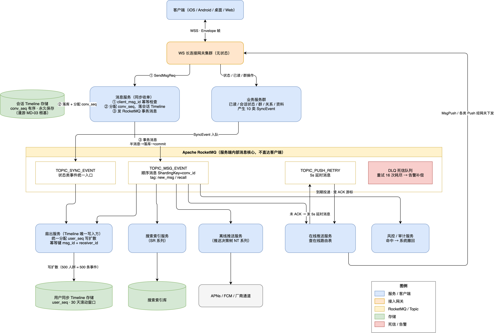
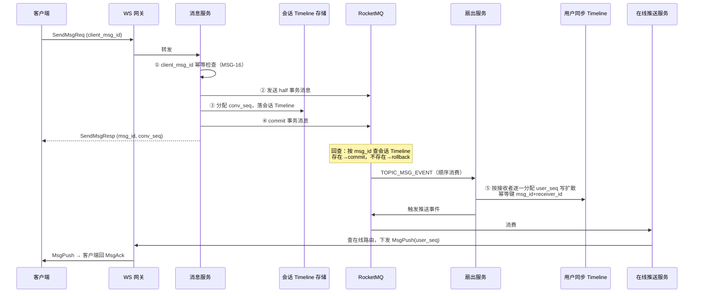

# Phantom IM 服务端消息核心架构设计（RocketMQ）

- 日期：2026-08-07
- 状态：待评审
- 上游规格：[IM 通讯协议设计](2026-08-07-im-protocol-design.md)（双 Timeline 混合同步模型）
- 需求来源：docs/prd/（MSG / MD / CV / NT / SR / SEC 系列）

## 0. 设计决策记录

| 决策点 | 结论 | 理由 |
|---|---|---|
| 消息中间件 | Apache RocketMQ | 借鉴钉钉消息系统同源架构：事务消息、顺序消息、延时消息、消费重试 + DLQ 一站式覆盖 IM 可靠性需求 |
| 同步/异步边界 | conv_seq 分配与会话 Timeline 落库同步完成，其余全部异步 | conv_seq 是"不乱序"与漫游（MD-03）的根基，必须在返回 SendMsgResp 前确定 |
| 落库与投递原子性 | RocketMQ 事务消息（非本地 Outbox 表） | 省去 outbox 表与扫描任务；回查逻辑天然可查会话 Timeline |
| 扇出模型 | 纯写扩散，不预留读扩散降级 | PRD 限定群上限 500 人（GC-02），写放大可控，遵循 YAGNI |
| user_seq 写入方 | 扇出服务为用户同步 Timeline 唯一写入方 | 保证 user_seq 单调递增有唯一权威，避免多服务并发写竞态 |
| MQ 触达范围 | 止于服务端内部，不直达客户端 | 最后一公里仍由 WS 网关按协议下发 MsgPush/Envelope，协议层零改动 |

## 1. 总体架构

（源文件：`diagrams/mq-message-core.drawio`，可用 draw.io 打开编辑）

核心思想：**同步链路只做"收单"，其余全部异步化**。发消息的同步闭环仅包含：幂等检查 → 分配 conv_seq → 落会话 Timeline → 发事务消息 → 回 SendMsgResp。之后的写扩散、在线推送、离线推送、搜索索引、风控审计全部由 RocketMQ 驱动的消费组异步完成。

收益：

1. **削峰填谷**：500 人群的 1→500 写放大被 MQ 缓冲，发送 RT 与扇出规模解耦；
2. **可靠性外包**：消费失败自动重试（最多 16 次）+ 死信队列兜底，"不丢"不依赖业务代码手写重试；
3. **解耦扩展**：新增下游（搜索、数据分析等）= 新增一个 Consumer Group，发送主链路零改动。

## 2. 发送链路

关键约束：

- **conv_seq 分配不进 MQ**：同一会话内的 conv_seq 由消息服务在同步链路内分配（会话粒度取号），保证 SendMsgResp 返回时排序已确定（MSG-15）；
- **受限投递（DC-16/18）**：消息服务判定受限后仍正常返回成功并落会话 Timeline，但事务消息携带 restricted 标记，扇出服务只为发送者本人端写事件，并追加 RestrictedDeliveryEvent。

## 3. 可靠性三要素与 RocketMQ 机制映射

| PRD 硬约束 | 服务端机制 | 客户端协议机制（已有） |
|---|---|---|
| 不丢 | 事务消息（落库与投递原子）+ 消费重试 16 次 + DLQ 告警补偿 | MsgAck 游标 + SyncReq 兜底 |
| 不重 | 消费侧幂等键 `msg_id + receiver_id`（写 userSeq 事件前查重） | `client_msg_id` 发送幂等（MSG-16）+ `msg_id` 展示去重 |
| 不乱序 | conv_seq 同步分配 + 顺序消息（ShardingKey=conv_id 恒定路由同一队列串行消费） | 按 conv_seq 排序渲染，按 user_seq 排序回放 |

## 4. Topic 与 Consumer Group 规划

| Topic | 消息类型 | 生产者 | 消费组 | 说明 |
|---|---|---|---|---|
| `TOPIC_MSG_EVENT` | 顺序消息，ShardingKey=`conv_id` | 消息服务 | 扇出 / 在线推送 / 离线推送 / 搜索索引 / 风控审计 | tag 区分 `new_msg` / `recall`；事务消息发送 |
| `TOPIC_SYNC_EVENT` | 普通消息 | 各业务服务（已读/会话状态/群/关系/资料） | 扇出服务 | 10 类 SyncEvent 的统一入口，由扇出服务统一分配 user_seq |
| `TOPIC_PUSH_RETRY` | 定时消息（5s） | 在线推送服务 | 在线推送服务 | 承接"5 秒未 ACK 重推一次"（协议 3.5），网关无状态化 |
| `%DLQ%*`（自动） | 死信 | — | 告警服务 | 重试耗尽进死信 → 告警 + 人工补偿，"不丢"的最后兜底 |

规划原则：

- **user_seq 唯一写入方**：所有需要进入用户同步 Timeline 的事件（消息与 10 类状态事件）统一经 MQ 汇入扇出服务，由它分配 user_seq，杜绝并发写 Timeline 的序号竞态；
- **顺序消息只用于 `TOPIC_MSG_EVENT`**：状态类事件本身以服务端合并语义（撤回优先、状态取终态）容忍乱序，走普通消息换吞吐；
- **撤回复用消息通道**：RecallMsg 以 `tag=recall` 进入同一顺序队列，保证同会话内"先消息后撤回"的消费顺序。

## 5. 延时重推：网关无状态化

协议 3.5 规定"MsgPush 5 秒未收到 MsgAck 则重推一次"。不在网关内存挂定时器（网关重启即丢失），改为：

1. 在线推送服务下发 MsgPush 的同时，向 `TOPIC_PUSH_RETRY` 发一条 **5 秒延时消息**（携带 receiver_id + user_seq）；
2. 到期消费时对比该用户的 ACK 游标：`acked_user_seq >= user_seq` 则丢弃，否则重推一次；
3. 重推后不再续发延时消息——继续未达由客户端 SyncReq 兜底（协议三级必达的第三级）。

由此 WS 网关完全无状态，可随意扩缩容与滚动发布。

## 6. 边界：不引入的部分

- **MQ 不是推送通道**：RocketMQ 止于服务端内部，客户端只感知 WS 网关的 Envelope 帧，协议（proto/）零改动；
- **不做读扩散降级**：钉钉对万人群切读扩散省写放大；本项目群上限 500（GC-02），纯写扩散足够，不预留该复杂度；
- **Typing / Presence 不进 MQ**：不落库、时效敏感（协议 5.1），网关间直接路由，进 MQ 徒增延迟；
- **不用 MQ 广播模式做多端同步**：多端一致性已由用户同步 Timeline + 单游标解决（MD-05），广播会绕过 user_seq 权威。

## 7. 失败场景推演

| 场景 | 表现 | 恢复路径 |
|---|---|---|
| 落库成功、commit 前消息服务宕机 | half 消息悬挂 | Broker 回查 → 查到会话 Timeline 有该 msg_id → commit |
| 落库失败 | half 消息悬挂 | 回查查不到 → rollback；客户端超时重发（client_msg_id 幂等） |
| 扇出服务消费失败 | 自动重试（间隔递增） | 幂等键防止已写接收者重复；16 次耗尽进 DLQ 告警 |
| 扇出滞后（堆积） | 接收端延迟收到 | 客户端在线仍可经 SyncReq 拉到已扇出部分；监控消费堆积告警扩容 |
| 推送服务宕机 | MsgPush 未下发 | MQ 未 ACK 消息重投给同组其他实例；最终 Sync 兜底 |

## 8. PRD 覆盖对照（本篇新增部分）

| 需求 | 机制 |
|---|---|
| MSG-13/14 消息必达 | 事务消息 + 消费重试 + DLQ + 延时重推 + Sync 兜底 |
| MSG-15 会话内有序 | conv_seq 同步分配 + conv_id 顺序消息 |
| MSG-16 幂等 | client_msg_id（收单）+ msg_id+receiver_id（扇出） |
| MD-05 多端增量同步 | 扇出服务唯一写入 user_seq |
| GC-02 500 人群 | 写扩散经 MQ 削峰，扇出异步化 |
| NT 系列推送 | 离线推送服务独立消费组，决策树独立演进 |
| SR 系列搜索 | 搜索索引消费组，主链路零侵入 |
| SEC-06 内容风控 | 风控消费组异步复核，命中发起系统撤回（operator="SYSTEM"） |

## 9. 交付物

- 本设计文档
- 架构图源文件 `diagrams/mq-message-core.drawio` 及导出图 `diagrams/mq-message-core.drawio.png`（内嵌 XML，可直接用 draw.io 打开编辑）
